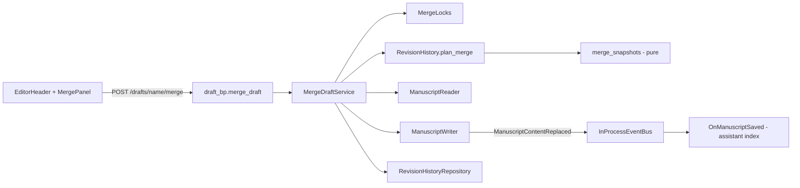

# Design Document: merge-drafts

## Overview

A merge brings the head of a source draft into the current draft as one new revision. It is a three-way merge at section and field granularity, computed by a pure function in the `revision_history` domain, orchestrated by a new `MergeDraftService`, and exposed as `POST .../drafts/{name}/merge`. The frontend enables the existing Merge button and adds a `MergePanel` dialog with conflict resolution.

The code follows the existing layout in `backend/domain/revision_history` (models, services, ports, adapters, api) and the wiring in `bootstrap/contexts/revision_history/module.py`. Only new or changed pieces are described here.

### Findings from the code that shape the design

| Finding | Consequence |
| --- | --- |
| `Revision` is a frozen dataclass with no provenance. Mongo stores revisions once in `revisions` and drafts hold ordered ids (`mongodb_revision_history_repository.py`). | Add an optional `merged_from` to `Revision` and to the revision document. Old documents read back as `None`. |
| `RestoreRevisionService` and `SwitchDraftService` publish no event. Only `EditSectionBodyService` publishes `ManuscriptSaved` (per section, with `project_id`). Requirement 7.9 assumes restore already publishes. | Introduce a `ManuscriptContentReplaced` event emitted by `Manuscript.replace_sections`, published by the writer adapter. Restore and switch then publish it too. The assistant subscribes the existing `OnManuscriptSaved` handler, which only reads `manuscript_id` and `project_id`. |
| The commit endpoint is protected only by `@login_required`. There is no project-level access check anywhere in `revision_history`. | Requirement 7.4 is met by using `@login_required` (401), the same as commit. No new authorization is introduced. |
| The backend has no "unsaved" concept. The working copy is the manuscript aggregate, and the revision head is a stored snapshot. | Unsaved changes means the reader snapshot differs from the current draft head, compared with sections sorted by id. |
| `Mongo.save` is an unconditional `replace_one`. Repositories have no versioning. | Add an optimistic `version` to the history document and an in-process lock (the deployment is single worker per `docs/architecture.md`). |
| `apiFetch` (`frontend/src/lib/api/http.js`) keeps only `message`, `code` and `status` from an error body. | The conflict list in a 409 body is lost. Extend it to also attach `conflicts` and `details`. |
| `editor.svelte` has no dirty tracking. | Add a `dirty` flag (set on editor update, cleared after load and successful save) and pass it to the header. |
| `DomainError` maps to HTTP 400 globally. The merge API needs 404, 409 and 422. | Register specific handlers in `bootstrap/error_handlers.py`. Flask resolves the most specific class first. |

### Key decisions

- **Target is always the current draft.** The path names the source only, and the panel shows the current draft as target (Requirement 8.6). A merge request therefore carries the source draft in the URL and the target is implicit (8.8 is satisfied by the panel's state, not a body field).
- **Plan, then apply.** The aggregate computes the merge revision without mutating anything. The service writes the working copy, then attaches the revision and saves. This keeps the in-memory repository, which returns the live aggregate, from showing a half-applied merge (Requirement 6.3).
- **Ordinals are compared as sibling ranks.** Raw ordinals have gaps and start at 1 in `Manuscript.append_section`, so before comparing, each snapshot's ordinals are replaced by their 0-based rank among siblings (ties by id). This is the same normalization as Requirement 3.9, applied to inputs as well as output, and avoids false conflicts from gaps. A known limit: inserting a section in the same parent on both drafts still shifts sibling ranks on both sides and can produce `ordinal` conflicts (see Open Questions).
- **Conflict values for whole-section conflicts** (deleted vs modified, `field = "section"`) are the section as an object of its four fields, or `null` for the side that deleted it.

## Architecture



```mermaid
sequenceDiagram
  participant S as MergeDraftService
  participant R as Repository
  participant M as Reader/Writer
  S->>S: try-acquire lock(manuscript) else MergeInProgressError
  S->>R: load history (version v)
  S->>M: read working snapshot; compare with head
  S->>S: plan_merge -> Revision (no mutation)
  S->>M: apply_snapshot(merged)
  S->>R: attach revision, save (CAS on v)
  Note over S,M: on save failure: re-apply previous working snapshot, drop revision, re-raise
  S->>S: release lock
```

## Components and Interfaces

### Domain (`backend/domain/revision_history/models`)

- `value_objects.py`: `MergeSource(draft_name: str, head_revision_id: RevisionId)`, frozen.
- `entities.py`: `Revision` gains `merged_from: MergeSource | None = None` after `created_at`, so existing positional construction keeps working.
- `merge.py` (new, pure, no I/O):
  - `Choice = Literal["target", "source"]`, `Resolution(section_id: UUID, field: str, choice: Choice)`.
  - `Conflict(section_id, section_heading, field, kind, base, target, source)`.
    - `field`: `heading | body | parent_id | ordinal | section`.
    - `kind`: `field_conflict | deleted_in_target | deleted_in_source | parent_cycle | parent_missing`.
  - `merge_snapshots(base, target, source, resolutions) -> MergeOutcome`, where `MergeOutcome` is either `Merged(snapshot)` or `Conflicts(list[Conflict])`. Also exposes `detect_conflicts` (the resolution-free pass) so the service can validate resolutions.
  - `normalize(snapshot)`: sibling-rank ordinals, pre-order tree emission (siblings by `(ordinal, id)`).
- `errors.py` adds, all under `RevisionError`:

  | Class | `code` |
  | --- | --- |
  | `DraftNotFoundError` (raised by `_branch`, so existing 400 behavior is unchanged) | `revision.draft_not_found` |
  | `NoSharedHistoryError` | `revision.no_shared_history` |
  | `UnsavedChangesError` | `revision.unsaved_changes` |
  | `MergeConflictError(conflicts)` | `revision.merge_conflict` |
  | `InvalidResolutionError(kind, section_id, field)` | `revision.invalid_resolution` |
  | `MergeInProgressError` | `revision.merge_in_progress` |
  | `ConcurrentModificationError` | `revision.concurrent_modification` |

- `aggregates.py`, `RevisionHistory`:
  - `version: int` (default 0), set by `rehydrate` and bumped by the repository after a successful save.
  - `find_merge_base(target, source) -> Revision`: walk the target's revision list. Candidate A is the last revision whose id is in the source's id set. Candidate B is the `merged_from.head_revision_id` of the last target revision whose recorded head id is in the source's id set. Take B if its merge revision is positioned after A, else A. If neither exists, raise `NoSharedHistoryError`. Matching is by revision id, so a renamed source still matches (Requirement 2.4). The base snapshot is looked up in the source's revisions when the base is B.
  - `plan_merge(target, source, resolutions, message) -> Revision`: validates `target != source`, finds the base, runs `merge_snapshots`, and returns an unattached `Revision` with `merged_from=MergeSource(source, source.head.id)`. Raises `NoChangesError` when the source head equals the base or the merged snapshot equals the normalized target head, and `MergeConflictError` when conflicts remain. Never mutates.
  - `attach(branch_name, revision)`: appends a planned revision to a branch.

### Ports and adapters

- `ManuscriptWriter.apply_snapshot` is unchanged. `ManuscriptRepositoryWriter` takes an `EventPublisher`, skips the save and event when the incoming snapshot equals the stored one (Requirement 7.10), and otherwise saves and publishes `manuscript.pull_events()`.
- `Manuscript.replace_sections` (manuscript domain) records `ManuscriptContentReplaced(manuscript_id, project_id)` defined in `domain/manuscript/models/events.py`.
- `build_container` passes `event_bus` to the writer. `build_assistant_module` subscribes `on_manuscript_saved` to `ManuscriptContentReplaced` as well.
- `RevisionHistoryRepository`: no signature change. `save` raises `ConcurrentModificationError` when the stored version differs from the one loaded.
  - In-memory: compares `history.version` against a per-manuscript stored version, then bumps it.
  - Mongo: adds `version` to the history document. `replace_one` filters on `{_id, version: v}` (for `v == 0` also matches documents with no `version`) and writes `v + 1`. `matched_count == 0`, or a duplicate-key error on the upsert, raises `ConcurrentModificationError`. New revision documents are inserted before the replace, as today. If the replace fails, the service deletes nothing; the next successful `save` removes the unreferenced documents through the existing orphan clean-up.

### Service (`services/merge_draft.py`)

```python
class MergeDraftService:
    def __init__(self, repository, reader, writer, locks: MergeLocks): ...
    def execute(self, manuscript_id: str, source: str, resolutions: Sequence[Resolution],
                message: str | None) -> Branch: ...
```

Order of checks: lock (non-blocking) → history exists (`HistoryNotFound`) → manuscript exists (`ManuscriptNotFound`) → message length 1 to 256 → unsaved changes → source exists and differs from current → `plan_merge` (after validating resolutions against `detect_conflicts`, raising `InvalidResolutionError` for a section/field not in the current conflict set) → apply snapshot → attach and save. If `save` raises, the service re-applies the working snapshot it read earlier, then re-raises. If `apply_snapshot` raises, nothing else has been touched. `MergeLocks` is a small class holding a `dict[str, threading.Lock]` guarded by one lock, with `try_acquire(key)` as a context manager. This guarantees one winner per process. The version check guards the history document if more than one process ever runs. It does not guard against a manual save made while a merge runs; that window is covered only by the unsaved-changes check at the start.

### Merge algorithm (`merge_snapshots`)

1. Normalize base, target and source; index each by section id.
2. For every id in the union, sorted ascending:
   - In base and in both drafts: merge each of the four fields with `merge3(b, t, s)`: if `t == s` use `t`; else if `t == b` use `s`; else if `s == b` use `t`; else record a `field_conflict`.
   - In base, absent in one draft: if the other draft left every field equal to base, omit the section. Otherwise record `deleted_in_target` or `deleted_in_source`.
   - Absent in base, present in one draft: take it. Present in both: take it when equal, otherwise `merge3` per field with base `None` (a "both added" collision on the same id is not covered by the requirements; it is treated as field conflicts).
3. Apply resolutions to the conflicts of step 2. For a resolved deletion, "delete" removes the section and every descendant of it in the merged tree; "keep" takes all four fields of the section, and of its descendants that exist on the keeping side, from that side.
4. Validate structure on the result (unresolved conflicts default to the target value for this check): report `parent_missing` for a `parent_id` not in the merged set, and `parent_cycle` on every section of a cycle whose `parent_id` differs between source and base.
5. A resolution whose `(section_id, field)` appears in the resolution-free conflict set is applied. A structural conflict that first appears only after resolutions are applied is returned as a new conflict (Requirement 5.9).
6. If any conflict remains, return `Conflicts` sorted by `(section_id, field)`. Otherwise renumber ordinals to consecutive integers per parent and return `Merged`.

### API (`api/routes.py`, `api/requests.py`)

```python
class ResolutionRequest(BaseModel):
    section_id: UUID
    field: Literal["heading", "body", "parent_id", "ordinal", "section"]
    choice: Literal["target", "source"]

class MergeDraftRequest(BaseModel):
    message: str | None = Field(default=None, min_length=1, max_length=256)
    resolutions: list[ResolutionRequest] = Field(default_factory=list, max_length=1000)
    # model_validator: reject duplicate (section_id, field) pairs
```

`@draft_bp.post("/<name>/merge")` with `@login_required`. Validation failure returns 422 with `details` (this endpoint uses 422 per Requirement 7.3 while older endpoints use 400). Success returns `200` with `_draft(draft, current=True)`.

| Condition | Status | Body |
| --- | --- | --- |
| Success | 200 | Draft shape |
| Not logged in | 401 | from `login_required` |
| Invalid body, duplicate or unmatched resolution | 422 | `{error, code?, details}` |
| `HistoryNotFound` / `ManuscriptNotFound` | 404 | `{error: "History not found" \| "Manuscript not found"}` |
| `DraftNotFoundError` | 404 | `{error: "Draft not found", code}` |
| `NoChangesError`, `UnsavedChangesError`, `MergeInProgressError`, `ConcurrentModificationError` | 409 | `{error, code}` |
| `MergeConflictError` | 409 | `{error, code: "revision.merge_conflict", conflicts: [...]}` |
| Other `RevisionError` (self-merge, no shared history, bad message) | 400 | existing `DomainError` handler |

Each conflict in the list has `section_id`, `section_heading`, `field`, `kind`, `base`, `target`, `source`. The 404 and 409 mappings go in `bootstrap/error_handlers.py` (specific classes) and `routes.py` (the "which one was not found" wording). `docs/api.md` gets a merge subsection under Drafts (request, 200, every row above), and `docs/architecture.md` gets merge semantics in "Version control model" (Requirements 7.11, 7.12).

### Frontend

- `lib/api/http.js`: `apiFetch` also attaches `conflicts` and `details` from the error body to the thrown error.
- `lib/api/drafts.js`: `mergeDraft(projectId, manuscriptId, sourceName, { resolutions, message })`, a `POST .../{name}/merge` with `signal: AbortSignal.timeout(30000)`.
- `lib/mergeDraft.js` (pure helpers): `conflictKey(c)` = heading + field; `carryOverChoices(prevChoices, newConflicts)` (Requirement 9.5); `toResolutions(conflicts, choices)`; `valuePreview(field, value)` (a `body` is a tiptap JSON string, so the preview extracts its text and truncates to 200 characters).
- `components/editor/MergePanel.svelte` (new). Props: `projectId`, `id`, `currentDraft`, `drafts`, `hasUnsavedChanges`, `onmerged(source, target)`, `onclose`. It is a modal (`role="dialog"`, `aria-modal`, labelled by its title). State: `source`, `conflicts`, `choices`, `phase: "idle" | "merging"`, `error`.
  - Draft list is a native `<select>` or radio group of every draft except the current one, with no default; the target name is shown as read-only text.
  - Confirm is `disabled` while no source is chosen, `hasUnsavedChanges` is true (with a "save before merging" message), a request is in flight (with a progress indication), or any conflict lacks a choice.
  - Each conflict is a `<fieldset>` with a `<legend>` of "heading, field" and two radios (`target`, `source`), each with an `aria-label` containing the heading and field. Native tab, arrow and space behavior covers keyboard use; Enter on the confirm button submits. Escape on the dialog calls `onclose` and drops state.
  - Handling responses: `revision.merge_conflict` sets `conflicts` and runs `carryOverChoices`; `revision.no_changes` shows "nothing new to merge"; other errors and timeouts set `error`. In all error cases the panel stays open and keeps the selection and choices. Changing `source` clears `conflicts` and `choices`.
- `EditorHeader.svelte`: replace the disabled button and the `TODO(API): MERGE` comment. New prop `hasUnsavedChanges` and `onMerge`. A derived `mergeDisabledReason` returns, in order: "Draft tracking has not started" (`!draftsStarted`), "At least two drafts are required" (`drafts.length < 2`), "A draft operation is in progress" (`draftBusy`), else `""`. The button's `disabled` and `title` follow it. Opening sets `mergeOpen = true` after `loadDrafts()` if the list is empty. On success the header calls `loadDrafts()`, closes the panel and calls `onMerge(source, target)`.
- `pages/editor.svelte`: `dirty` state (set in the Editor's `onUpdate`, cleared right after `setContent` in `loadManuscript` and after a successful `save`), passed as `hasUnsavedChanges`. `onMerge(source, target)` calls `loadManuscript()` and sets `notice = 'Merged "source" into "target".'`.

## Data Models

Revision document (`revisions` collection) gains an optional field. Absent means "not a merge revision".

```jsonc
{ "_id": "...", "manuscript_id": "...", "message": "...", "created_at": "...", "snapshot": [ ... ],
  "merged_from": { "draft": "feature-x", "head_revision_id": "..." } }   // optional
```

`revision_histories` documents gain an integer `version` (absent is read as 0). Draft documents are unchanged.

Merge request and conflict payloads:

```jsonc
// POST /drafts/{source}/merge
{ "message": "optional, 1-256", "resolutions": [ { "section_id": "uuid", "field": "body", "choice": "source" } ] }
// 409 revision.merge_conflict
{ "error": "...", "code": "revision.merge_conflict",
  "conflicts": [ { "section_id": "uuid", "section_heading": "Methods", "field": "body",
                   "kind": "field_conflict", "base": "...", "target": "...", "source": "..." } ] }
```

## Correctness Properties

*A property is a characteristic or behavior that should hold true across all valid executions of a system-essentially, a formal statement about what the system should do. Properties serve as the bridge between human-readable specifications and machine-verifiable correctness guarantees.*

Prework reflection merged the per-field criteria (3.1 to 3.8, 4.8) into one property and the failure-leaves-state criteria (1.9, 4.5, 5.8, 5.9, 6.1, 6.3) into one atomicity property. Properties apply to the pure merge engine and to `MergeDraftService` with in-memory fakes. HTTP mapping, concurrency and the UI use example tests.

### Property 1: Field-level merge rule

For any base snapshot and any pair of independent edits applied to target and source (field changes, section additions, section deletions), when no conflict arises the merged value of each section field equals the source value if only the source changed it, the target value if only the target changed it, and the shared value if both changed it to the same value; sections added by one side are present; sections deleted by one side and untouched by the other are absent; and the engine reports no conflict for any field where target equals source.

**Validates: Requirements 3.1, 3.2, 3.3, 3.4, 3.5, 3.6, 3.7, 3.8, 4.8**

### Property 2: Merged snapshot is well formed

For any base, target and source that merge without conflict, the merged snapshot has unique section ids, no `parent_id` cycle, no `parent_id` referencing an absent section, and for each parent the children's ordinals are exactly 0 to n-1 in the merged relative order with ties broken by ascending section id.

**Validates: Requirements 3.9, 10.3**

### Property 3: Merging a draft with no new changes is rejected

For any snapshot S, merging a source whose head equals the base into a target with head S, and merging a source into an unchanged copy of itself, both fail with `revision.no_changes`, and the merged snapshot of the engine equals the normalized S.

**Validates: Requirements 3.10, 3.11, 3.12, 10.2**

### Property 4: Fast-forward

For any normalized snapshots B and S, merging a source with head S into a target whose head equals the base B yields S.

**Validates: Requirements 3.13, 10.2**

### Property 5: Conflicts are detected exactly when both sides diverge

For any base, target and source, the engine reports a `field_conflict` for a section field if and only if target and source both differ from base and differ from each other, and reports a deletion conflict for a section if and only if exactly one side deleted it and the other side changed any of its fields. Every conflict carries the section id, the field, and the base, target and source values. Structural conflicts are reported for any merged tree that would contain a cycle or a missing parent, and only on sections whose `parent_id` changed in the source for cycles.

**Validates: Requirements 4.1, 4.2, 4.3, 4.4**

### Property 6: Merge computation is deterministic

For any histories and any ordering of the input sections, computing the base revision and the merge outcome twice yields the same base, the same snapshot or the same conflicts, and conflicts are sorted ascending by section id and then field name.

**Validates: Requirements 2.6, 4.7**

### Property 7: Resolutions select the chosen side

For any conflicting merge and any assignment of `target` or `source` to every conflict, supplying those resolutions produces a merged snapshot in which each conflicting field holds the chosen side's value; a deletion resolved to the deleting side removes the section and its descendants; resolved to the keeping side keeps the section with that side's values.

**Validates: Requirements 5.1, 5.2, 5.3, 5.4, 5.5**

### Property 8: Base revision selection matches a reference model

For any generated histories with shared prefixes and any sequence of earlier merges (including renames of the source), `find_merge_base` returns the revision given by a straightforward reference implementation: the later, by position in the target, of the last common revision and the last recorded source head found in the source's revisions.

**Validates: Requirements 2.1, 2.2, 2.4**

### Property 9: Rejected merges change nothing

For any merge that is rejected (unresolved conflicts, partial resolutions, a new structural conflict, unsaved changes, an invalid message, no changes, or a writer failure), the revisions of every draft, the current draft and the working copy snapshot are identical to their state before the request.

**Validates: Requirements 1.8, 1.9, 4.5, 5.8, 5.9, 6.1, 6.3**

### Property 10: Successful merge postconditions

For any successful merge, the target draft gains exactly one revision (its new head), the source draft's revisions are unchanged in count, content and order, the current draft is still the target, the working copy snapshot equals the new head's snapshot, the new revision records `merged_from` with the source's name and head id, and its message is the supplied message when one of 1 to 256 characters is given and `Merge draft '<source>' into '<target>'` otherwise.

**Validates: Requirements 1.2, 1.3, 1.4, 1.5, 1.6, 1.7, 2.3**

## Error Handling

- Error classes and their HTTP mapping are in the tables above. Domain errors carry user-readable messages, as with the existing `DomainError` handler.
- Pre-write failures (conflicts, validation, unsaved changes, missing draft or history, no changes) write nothing because the plan is computed before any write.
- Working copy write failure: nothing is attached, the history is not saved, and the error propagates (500 unless it is a mapped error such as `ManuscriptNotFound`).
- History save failure after the working copy changed: the service re-applies the previously read working snapshot and re-raises. If that compensation also fails, the failure is logged and the original error is raised; the working copy then needs manual recovery (Open Questions).
- Concurrent request: the second caller receives `revision.merge_in_progress` (409) without waiting.
- Frontend: all non-conflict errors and the 30 s timeout show a message in the panel and keep the panel, selection and choices. `apiFetch` already maps network failures to a readable message; an aborted request surfaces the same way.

## Testing Strategy

Property-based testing applies to the merge engine, base selection and the service's atomicity, because they are pure or in-memory logic with large input spaces. It does not apply to the HTTP mapping, Mongo adapter, event wiring or the Svelte components; those use example-based tests.

**Backend (pytest, Hypothesis, already present in `backend/.hypothesis`; tests under `backend/tests/domain/revision_history/`)**

- One Hypothesis test per Property 1 to 10, each with `@settings(max_examples=100)` (or more) and a comment `# Feature: merge-drafts, Property N: <title>`. Strategies generate acyclic section trees with unique ids, then derive target and source by applying random edit scripts (edit field, add, delete, reparent, reorder).
- Unit tests, each naming its requirement and criterion: Requirement 1.10 to 1.12 and 2.5 (hand-built histories, since `create_branch` always copies `main`), 2.4 rename example, 5.6, 5.7 and 5.10 (invalid resolutions), 6.2, 6.4 and 6.5 (two threads with a barrier, expecting exactly one new revision), 7.9 and 7.10 (a recording publisher sees exactly one `ManuscriptContentReplaced`, or none when the snapshot is unchanged), the in-memory and Mongo `version` check (Mongo test uses the existing fake or `mongomock` if the suite already has one), and `merged_from` and `version` persistence round trips for the Mongo mappers including documents without those fields.
- API tests (Flask test client) with one case each for 200, 404 (history, draft), 409 (conflict with full list, no_changes, unsaved_changes) and 422 (bad message, bad choice, duplicate and unmatched resolution, more than 1000 resolutions) asserting the status code (Requirement 10.5). The 401 case reuses the existing commit endpoint pattern.
- A service test submits a conflicting merge and asserts the history and working copy are identical afterwards and the conflict error is raised (Requirement 10.4).

**Frontend (Vitest and Testing Library, `*.spec.js` as in `components/text-sources`; the `node --test` runner only picks up `*.test.js`)**

- `EditorHeader` with the API modules mocked: the Merge button is enabled with two drafts, tracking started and no operation in progress, and disabled with the expected title for each of the other three states (Requirement 10.6).
- `MergePanel`: the conflict flow shows conflicts, keeps confirm disabled until every conflict has a choice, then sends one request containing one resolution per conflict (Requirement 10.7). Further cases: unsaved-changes message, `no_changes` message, generic error keeps state, Escape closes without a request, changing the source clears choices, and each radio's accessible name contains the heading and field.
- `lib/mergeDraft.js`: example tests for `carryOverChoices` and `valuePreview`. Not property tests, since the input space is small and fixed.

`npm run test:components` and the backend test command must both exit non-zero when any of these fail (Requirement 10.8); no extra configuration is expected beyond the standard runners.

## Open Questions

1. **Spurious ordinal conflicts.** Adding sections in the same parent on both drafts shifts sibling ranks on both sides and reports `ordinal` conflicts on untouched sections. Requirements fix `ordinal` as a mergeable field, so the design keeps that. Treating ordinal as relative order would remove most of these; it would need a requirements change.
2. **Compensation failure.** If the history save fails and the working-copy rollback also fails, the manuscript content differs from the draft head until the user switches draft or restores. This is rare and logged, not recovered automatically.
3. **Switch now publishes an event.** Because the writer publishes, `SwitchDraftService` also triggers re-indexing when content changes. This is likely desirable, but it is a behavior change beyond restore.
