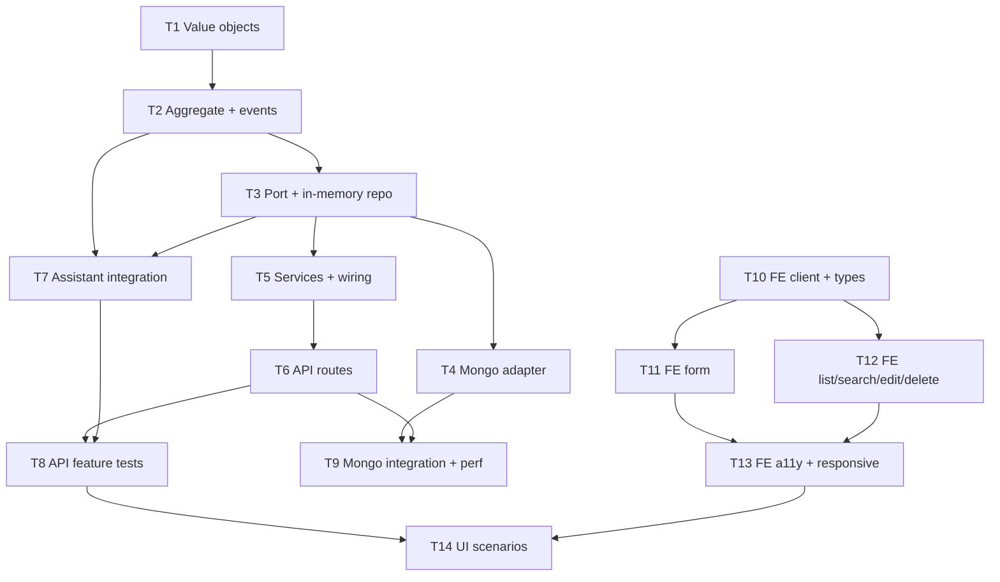

# Tasks: Source Library Text Upload

Specs: `requirements.md` (R/N), `design.md` (D). Each task lists only what to read/touch. Write tests with the code (TDD); no separate "tests later" tasks except cross-layer ones (T8, T12, T13).

## Dependency graph

**Parallel waves:** W1 `T1`, `T10` · W2 `T2`, `T11`, `T12` · W3 `T3` · W4 `T4`, `T5`, `T7` · W5 `T6`, `T13` · W6 `T8`, `T9` · W7 `T14`.
**Critical path:** T1→T2→T3→T5→T6→T8→T14.
Frontend (T10–T13) builds against the API contract in `design.md`; mock the client until T6 lands.

---

### T1 — Value objects · deps: none
- Files: `models/value_objects.py` (+ tests)
- Add `Description`, `Tags`, `ContentType`, `TextBody` with limits/normalization.
- Done: boundary tests pass (200/201 title n/a here; 1000/1001 desc, 10/11 tags, 0/1/100000/100001 body). R1, R2

### T2 — Aggregate + events · deps: T1
- Files: `models/aggregates.py`, `models/events.py`
- Add `kind`, text fields, `version`, `updated_at`; make `file_ref` optional with invariants (D6); `update_text()`; `SourceUpdated`; `kind` on `SourceAdded`.
- Done: invariants + version bump unit-tested; existing aggregate tests still pass. R1, R5, N4

### T3 — Port + in-memory repo · deps: T2
- Files: `infrastructure/ports/source_repository.py`, in-memory adapter
- Add `list_text`, `search_text`, update-capable `save`. Project-scoped; exclude removed.
- Done: adapter tests cover filter, sort, paging, search, isolation. R4, R6, R7, R8

### T4 — Mongo adapter · deps: T3
- Files: Mongo source adapter, index setup
- Implement T3 port; projection excludes `content`; indexes per design (check/extend existing text index); old docs map to defaults.
- Done: adapter contract tests (shared with T3) pass against Mongo; legacy doc loads as `kind=file`. R4, R7, N4

### T5 — Services + wiring · deps: T3
- Files: `services/*`, container wiring
- `AddTextSource`, `UpdateTextSource`, `ListTextSources`, `SearchTextSources`; reuse `GetSource`/`RemoveSource`. Emit events.
- Done: service tests with in-memory repo; events asserted. R1–R7, R11

### T6 — API layer · deps: T5
- Files: `api/routes.py`, `api/requests.py`, `api/errors.py`, limiter config
- Six `/text` endpoints per design; Pydantic request; DTO mapping; 400/404/429; body cap (D8); `/text/search` registered before `/text/<id>`.
- Done: Flask-client tests per endpoint incl. 401, foreign-project 404. R1–R10

### T7 — Assistant integration · deps: T2, T3
- Files: `on_source_added.py`, new `on_source_updated.py`, `on_source_removed.py`, `source_content_provider.py`, `ingestion_worker.py`
- Text ingest from `content`; reindex on update; drop on remove. Verify `file_ref` assumptions first.
- Done: handler tests (add/update/remove); file-source path unchanged. R11

### T8 — API feature tests · deps: T6, T7
- Files: step definitions for `source_library_text_upload.feature` (non-`@ui`, non-perf tags)
- Done: all API-level scenarios green on in-memory adapters, incl. `@grounding`. R1–R11

### T9 — Mongo integration + perf · deps: T4, T6
- Run key scenarios on Mongo; `@performance` (10 KB <2 s, 1,000 docs search <1 s), `@concurrency`, `@storage` (100K round-trip).
- Done: N1–N3, N5 verified; limiter thresholds tuned. R9

### T10 — Frontend client + types · deps: none
- Files: `lib/api/textSources.ts`, types
- Typed client + DTOs per design; error mapping to field errors.
- Done: unit tests against mocked fetch. R12

### T11 — Frontend form · deps: T10
- Files: `components/text-sources/TextSourceForm.svelte`
- Fields, counter, preview (`<pre>`, no `{@html}`), client-side limits, draft autosave/restore, create + edit modes, field errors.
- Done: component tests for counter, preview, draft restore, validation. R1, R2, R5, R12

### T12 — Frontend list/search/edit/delete · deps: T10
- Files: `TextSourceList.svelte`, `TextSourceCard.svelte`, delete confirm, route wiring
- Cards, pagination, search, filter, sort, open/edit, delete-confirm; empty state.
- Done: component tests; text sources visible in main library list. R4, R6, R7, R12

### T13 — Accessibility + responsive · deps: T11, T12
- Labels, keyboard path, `aria-live` errors, focus management, breakpoints.
- Done: axe checks clean; manual keyboard pass; mobile/tablet/desktop layouts. R12

### T14 — UI scenarios · deps: T8, T13
- Bind `@ui @accessibility @responsive` scenarios (Playwright or repo's e2e tool).
- Done: full feature file green. R12
