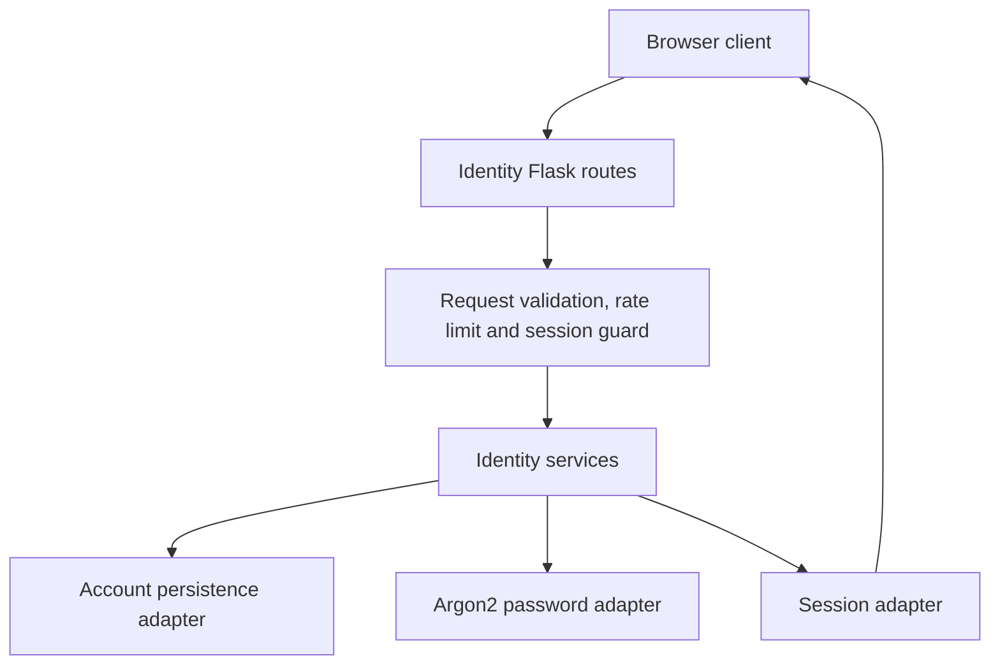
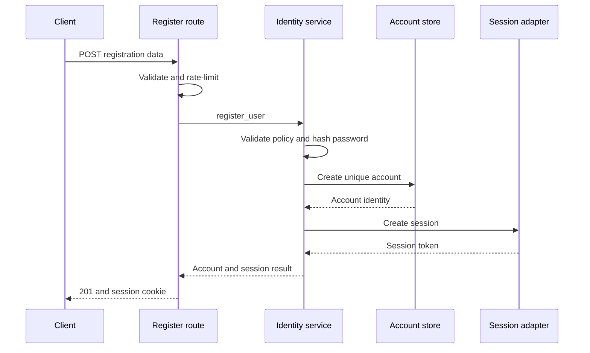

# System Specification and Design
## Identity & Access Management

**Project:** Theseus (THES)  
**Epic:** [THES-1](https://theseus-inc.atlassian.net/browse/THES-1) — Identity & Access Management  
**Prepared for:** Glen Suguitan  
**Date:** 7 November 2026  
**Status:** Review draft based on Jira; implementation not verified

This document covers only THES-1 and its five stories (THES-2, THES-10, THES-16, THES-20 and THES-24), including their 21 subtasks. Other Theseus epics are excluded. The source is the Jira issue snapshot retrieved on 7 November 2026; comments, attachments and repository code were not inspected. All 27 scoped issues were marked To Do, which is workflow metadata rather than proof of implementation status.

**Documented** identifies an explicit Jira requirement. **Proposed** identifies a design recommendation. **Open** identifies a detail Jira has not settled.

## 1. Design overview

The module exposes identity operations through Flask routes, validates request data using Pydantic, delegates business behavior to identity services, persists accounts through a storage adapter, and authenticates subsequent requests using a session cookie.

This is a design for the assigned epic, not a claim that the current code already implements it. Service names and known routes follow Jira. Proposed choices are explicitly identified so the team can review them without confusing them with accepted requirements.

## 2. Architecture and responsibilities



The logical components are documented or implied by the services and route subtasks. Separating hashing, storage and sessions into adapters is proposed. The session adapter's arrow back to the browser represents cookie issuance through the HTTP response, not a separate direct connection.

| Component | Responsibility | Jira source |
|---|---|---|
| Registration route | Validate input; invoke registration; return 201 and set cookie | THES-5, THES-7 |
| Login route | Validate input; invoke login; return 200 and set cookie | THES-10, THES-12 |
| /me route and login_required | Resolve the authenticated account; return 200 or 401 | THES-17, THES-18 |
| Logout route | Tear down session and clear cookie; return 204 | THES-21, THES-22 |
| Account-update route | Validate display_name; update current account | THES-25, THES-26 |
| create_account | Check uniqueness, hash password and persist account | THES-3 |
| register_user | Coordinate account creation and session creation | THES-4 |
| login_user | Verify password against Argon2 hash and create session | THES-11 |
| get_account / update_account | Read/update the current account | THES-17, THES-25 |
| auth_service.py | Authentication/session lifecycle, including teardown | THES-1, THES-21 |
| bootstrap/error_handlers.py | Map domain errors to HTTP responses | THES-6 |
| Flask-Limiter | Enforce identity endpoint request limits | THES-8, THES-14 |

**Documented service paths:** domain/identity/services/auth/register_user.py; domain/identity/services/auth/login_user.py; domain/identity/services/account/create_account.py; get_account.py and update_account.py under the account service directory; domain/identity/services/auth_service.py. Inspect the repository to confirm the actual layout before changing it.

## 3. Logical data model

The following persistence model is **proposed**. Jira requires account data and a session cookie but does not define a database schema or session backend.

| Record | Field | Purpose |
|---|---|---|
| Account | id | Stable internal identity; representation to confirm |
| Account | display_name | User-facing name, 1–128 characters |
| Account | email | Login identifier; uniqueness policy to agree |
| Account | normalized_email | Proposed uniqueness key under D02 |
| Account | password_hash | Argon2 hash; never plaintext |
| Account | created_at, updated_at | Proposed operational timestamps |
| Session | id | Internal session record ID |
| Session | token_hash | Proposed hash of the opaque bearer token sent in the cookie |
| Session | account_id | Account authenticated by this session |
| Session | created_at, expires_at, revoked_at | Proposed lifecycle controls |

**Proposed storage rules**

- Enforce uniqueness in persistent storage, not only with a pre-insert lookup.
- Keep password_hash, token_hash and raw tokens out of public response objects.
- Treat IDs supplied in account-update payloads as invalid or ignored under an agreed strict schema; the session determines whose account is updated.
- A session references an existing account. Expired, revoked or unresolved sessions fail authentication.
- Multiple sessions per account are permitted by this proposed model; single-device versus multi-device policy is open.

A server-side session model is proposed because it supports explicit revocation. If the repository uses a different session design, evaluate it against logout and expiry requirements before replacing it.

## 4. API specification

### 4.1 Shared conventions

Documented routes return JSON account data except 204 responses, which have no body. Pydantic handles request validation. Invalid registration/login field lengths return 400; password-strength failure returns 422.

Proposed conventions: application/json requests, strict field schemas, a shared safe error format and server-side session lookup. Exact validation detail formatting and code values remain open. Do not silently replace documented 400 responses with a framework default.

| Operation | Method and route | Required input | Success | Authentication |
|---|---|---|---|---|
| Register | POST /api/auth/register | display_name, email, password | 201 {id, display_name}; session cookie | Public |
| Login | POST /api/auth/login | email, password | 200 {id, display_name}; session cookie | Public |
| Current account | GET /api/auth/me | None | 200 {id, display_name, email} | Required |
| Logout | POST /api/auth/logout | No body required | 204; clear cookie | Safe with or without session |
| Update display name | PATCH /api/account **(proposed)** | display_name | 204 **(proposed)** | Required |

Registration/login input strings and display-name updates use the documented 1–128 character limits. The update path/method/response must be checked against existing routes before adoption (THES-26).

### 4.2 Request and response examples

The examples demonstrate documented field names. Sample ID format and values are illustrative, not a settled ID schema. The password placeholder must be replaced with a value that satisfies the agreed strength policy.

**Registration request**

```json
{
  "display_name": "Glen Suguitan",
  "email": "glen@example.com",
  "password": "<policy-compliant-password>"
}
```

**Registration 201 / login 200 response**

```json
{
  "id": "<account-id>",
  "display_name": "Glen Suguitan"
}
```

The HTTP response also sets the session cookie. The token is not added to the JSON response.

**Current account 200 response**

```json
{
  "id": "<account-id>",
  "display_name": "Glen Suguitan",
  "email": "glen@example.com"
}
```

**Proposed account-update request**

```json
{
  "display_name": "Glen"
}
```

After a successful update, GET /api/auth/me must return the new display name.

### 4.3 Error and rate-limit contract

| Condition | HTTP response | Evidence |
|---|---|---|
| Email already registered | 409; body contains error and code | THES-2 AC-2; THES-6 |
| Password fails strength rules | 422; error body | THES-2 AC-3; THES-6 |
| Registration/login fields outside 1–128 | 400 with Pydantic validation details | THES-2 AC-4; THES-10 AC-3 |
| Wrong password or unknown email | 401 with the same safe error behavior | THES-10 AC-2; THES-13 |
| /me without a session | 401 {"error":"Unauthorized"} | THES-16 AC-2 |
| Account update without a session | 401 | THES-24 AC-2 |
| Logout without a session | 204, no-op success | THES-23 |
| Invalid updated display-name length | 400 **proposed**; invalid-length test is documented | THES-27 |
| Registration/login rate exceeded | 429 with Retry-After **proposed** | Limits documented in THES-2/10; response details open |
| Expired/revoked/invalid session on protected route | 401 **proposed explicit behavior** | Supports the session-authentication requirement |

Documented limit: 5 requests per minute per IP on both registration and login. Decide whether the endpoints share a bucket or have separate buckets, how the time window is calculated and how client IP is derived behind trusted proxies. A deterministic limit test should use one controlled IP and the agreed bucket definition.

Proposed domain-error mappings use the documented names EmailAlreadyRegistered → 409, WeakPassword → 422 and InvalidCredentials → 401. Do not leak stack traces, hash values, tokens or distinctions between unknown login email and incorrect password.

## 5. Processing flows

### 5.1 Register an account

1. Apply the registration rate limit and validate request shape/lengths.
2. Apply the agreed email and password-strength policies.
3. create_account enforces email uniqueness, hashes the password with Argon2 and persists the account.
4. register_user coordinates account creation and session creation.
5. Return 201 with id/display_name and set the session cookie.

Steps 1–5 follow THES-2–8. Atomic uniqueness, email normalization and transaction handling are proposed implementation details. If persistence succeeds but session creation fails, follow decision D08; do not retry by blindly creating another account.



### 5.2 Log in

1. Apply the login rate limit and validate email/password lengths.
2. Resolve the account using the agreed email lookup policy.
3. Verify the supplied password against the Argon2 hash.
4. For an unknown account or wrong password, return the same 401 behavior.
5. On success, create a session and return 200 with id/display_name and a cookie.

Proposed: avoid account-existence leaks through distinct messages or obviously different processing paths. Exact timing mitigations depend on the chosen authentication implementation.

### 5.3 Inspect the current session

1. login_required extracts and validates the session.
2. get_account resolves the account from the authenticated identity.
3. Return id, display_name and email.
4. Missing session returns the documented 401 Unauthorized response; invalid/expired/revoked sessions should also return 401 under the proposed lifecycle design.

Read the latest account display name, rather than relying on a stale name copied into an old session token.

### 5.4 Log out

1. If a session is present, tear it down using auth_service.py.
2. Clear the cookie using its matching name, path and domain configuration.
3. Return 204 with no body.
4. If no session exists, still return 204.

Server-side invalidation is proposed to prevent an old token from remaining usable after logout. This makes the “session ends” behavior testable beyond browser cookie deletion.

### 5.5 Update the display name

1. Require a valid session.
2. Validate display_name at 1–128 characters.
3. Resolve the target account from the session.
4. update_account persists the new value.
5. Return the agreed success response; subsequent /me reads reflect the update.

The persistence/read-back behavior is documented. PATCH /api/account and 204 are proposed contract choices. Changes to email or password are outside this story.

## 6. Session and security specification

All controls below are **proposed implementation details** unless otherwise noted.

| Control | Design intent |
|---|---|
| Opaque session token | Avoid storing sensitive account data in the cookie; generate an unpredictable token. |
| HttpOnly and Secure cookie attributes | Restrict script access and transmission to HTTPS. |
| SameSite and CSRF policy | Choose settings for the actual frontend/backend deployment; protect cookie-authenticated mutations. |
| Expiry and revocation | Reject expired/revoked sessions; define idle/absolute timeouts and renewal. |
| Cookie deletion | Match cookie scope so logout removes the issued cookie. |
| Password handling | Never log passwords; retain only Argon2 hashes in persistence, as Jira requires. |
| Output handling | Escape display names when rendered as text; do not treat names as HTML. |
| Error handling | Return safe messages while recording redacted diagnostics for debugging. |
| Session isolation | Derive account identity from the validated session for /me and update. |

No timeout values, cookie name, storage technology or Argon2 cost settings are invented as accepted requirements. Review these decisions before release.

## 7. Suggested client behavior

These are proposed interactions; the frontend implementation is not specified by the epic.

| View/action | Expected client behavior |
|---|---|
| Registration form | Collect name/email/password; show validation, duplicate-email and weak-password messages; continue as authenticated on 201. |
| Login form | Collect email/password; use a generic credentials error for 401; respect rate-limit retry guidance. |
| Session initialization | Call /api/auth/me; show current identity on 200 and unauthenticated state on 401. |
| Account settings | Edit only display name; show the saved value after confirmation from the API. |
| Logout action | Call POST /api/auth/logout; clear client account state after success. |

Do not add password reset, email verification or third-party sign-in controls to this epic's implementation scope.

## 8. Verification and traceability

| Design area | Requirement | Jira story | Test subtask |
|---|---|---|---|
| Registration flow, hashing, session creation | FR-01 | [THES-2](https://theseus-inc.atlassian.net/browse/THES-2) | [THES-9](https://theseus-inc.atlassian.net/browse/THES-9) |
| Credential verification and rate limiting | FR-02 | [THES-10](https://theseus-inc.atlassian.net/browse/THES-10) | [THES-15](https://theseus-inc.atlassian.net/browse/THES-15) |
| Session guard and latest account details | FR-03 | [THES-16](https://theseus-inc.atlassian.net/browse/THES-16) | [THES-19](https://theseus-inc.atlassian.net/browse/THES-19) |
| Session teardown and cookie clearing | FR-04 | [THES-20](https://theseus-inc.atlassian.net/browse/THES-20) | [THES-23](https://theseus-inc.atlassian.net/browse/THES-23) |
| Validated display-name update | FR-05 | [THES-24](https://theseus-inc.atlassian.net/browse/THES-24) | [THES-27](https://theseus-inc.atlassian.net/browse/THES-27) |

Proposed integration check: register → GET /me → update name → GET /me → logout → GET /me returns 401 → log in again → GET /me shows the persisted name. Validate both HTTP results and persistence/session effects.

Additional checks: concurrent duplicate registration, invalid/expired/revoked sessions, cookie clearing with configured scope, no plaintext credentials in storage/logs, and no cross-account update through injected IDs. These are proposed supplements to the documented tests. No application tests were executed during document creation.

## 9. Open design decisions

| ID | Open detail | Proposed direction |
|---|---|---|
| D01 | Exact password-strength rules and Argon2 parameters | Agree a strength policy and tested hash configuration; the 1–128 character request limit does not itself define password strength. |
| D02 | Email syntax, normalization and case-insensitive uniqueness | Agree one normalization rule and enforce uniqueness atomically; preserve the intended display form. |
| D03 | Session backend, cookie name/attributes, expiry, renewal and revocation | Use an opaque cookie token backed by revocable server-side sessions; confirm before implementation. |
| D04 | Account-update route, HTTP method and success response | Propose PATCH /api/account with display_name and 204 success; inspect the repository first to avoid duplicating an existing route. |
| D05 | Invalid account-update length response and validation details | Propose 400 using the same request-validation contract as other identity routes. |
| D06 | Rate-limit response, window algorithm and trusted client-IP resolution | Propose 429 with Retry-After; document whether login and registration have separate 5/minute/IP buckets. |
| D07 | Error code values and error-body schema | Define stable codes while retaining Jira's error field and Pydantic validation details. |
| D08 | Partial registration failure after account persistence but before session creation | Propose account/session atomic creation where supported; otherwise define a recoverable response and login path without creating duplicate accounts. |
| D09 | Email/display-name trimming, missing fields and wrong JSON types | Define validation explicitly; do not infer whitespace rejection solely from minimum length. |
| D10 | Performance, availability, retention and session storage capacity | Set measurable targets with the team; Jira provides no numeric service targets. |
| D11 | CSRF protection, HTML output escaping and logging policy | Apply CSRF protection to cookie-authenticated mutations; escape display names on rendering; redact credentials and session tokens. |

## 10. Implementation handoff

1. Inspect the identity routes, domain services and adapters already present in the repository.
2. Resolve D01–D09 and D11 before freezing behavior; define operational targets in D10.
3. Implement account persistence and hashing, then registration/login and session handling.
4. Implement /me, safe logout and the existing or agreed account-update route.
5. Wire rate limits and error mappings; run the five Jira test groups and the integration sequence.
6. Confirm the implementation satisfies each acceptance criterion in **THES-1_Requirements_Analysis.md**.

This specification concerns only Identity & Access Management. No Jira issues or repository code were changed while producing it.

