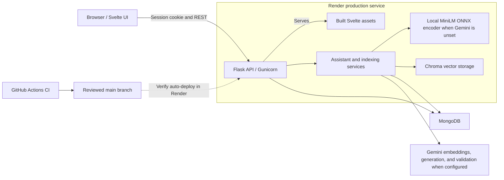

# Theseus architecture

Theseus is a manuscript editor with saved revisions, draft branches, and a retrieval-assisted writing assistant.

Flask owns authentication, authorization, persistence, and provider calls. The Docker image packages the frontend and backend together so the production UI can use same-origin API requests. The development server uses Vite. MongoDB supports persistent operation, while the default local configuration uses in-memory repositories.

## Domain-driven design

The backend organizes business rules into bounded contexts under [`backend/domain`](../backend/domain). Each context uses terminology from its part of the manuscript workflow.

| Bounded context | Responsibility |
| --- | --- |
| Identity (`identity`) | User accounts, authentication, and OAuth sign-in. |
| Project (`project`) | Project ownership and membership. |
| Manuscript (`manuscript`) | Manuscript content and section edits. |
| Revision history (`revision_history`) | Saved revisions, draft branches, restores, and merges. |
| Source library (`src_lib`) | Reference sources and their lifecycle. |
| Assistant (`assistant`) | Document indexing, evidence retrieval, and writing conversations. |

Flask routes in `api/` translate HTTP requests into use-case calls in `services/`. Those services load and save aggregates through repository interfaces. The aggregates and value objects in `models/` enforce business rules. For example, the `RevisionHistory` aggregate prevents renaming or deleting the main draft. [Revision history aggregate](../backend/domain/revision_history/models/aggregates.py)

Interfaces in `infrastructure/ports/` define dependencies such as repositories and event publishers. Implementations in `infrastructure/adapters/` connect those interfaces to storage and external providers. The bootstrap container supplies the adapters for local in-memory or persistent operation. For example, editing a section calls the `Manuscript` aggregate, saves it through the repository, and publishes the resulting domain events. [Bootstrap container](../backend/bootstrap/container.py) · [Section editing use case](../backend/domain/manuscript/services/edit_section_body.py)

## Database relationships

| Records | Relationship used by the app |
| --- | --- |
| Users and projects | Projects refer to their owner and members by user ID. The API checks project access before serving project resources. |
| Projects and manuscripts | Manuscripts belong to a project. Manuscript routes resolve them within that project. Manuscripts embed sections. |
| Manuscripts and revision histories | Histories are keyed by manuscript ID and track saved revisions and draft branches. |
| Sources and indexed documents | Indexed document records refer to sources or manuscripts and track indexing state. Chroma stores searchable chunks separately. |
| Projects and conversations | Conversations belong to a project and store exchanges and saved context references. |

Relationships are enforced by application logic. See [MongoDB wiring](../backend/bootstrap/container.py) and the [API reference](api.md).
