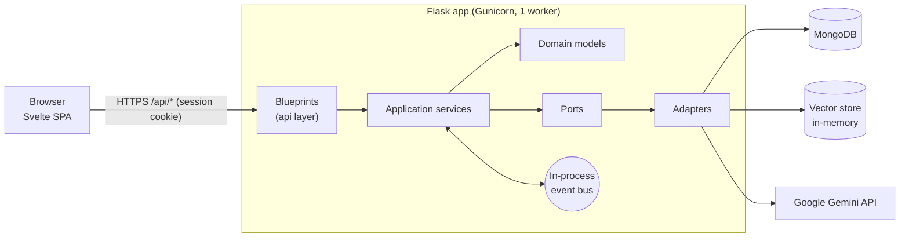
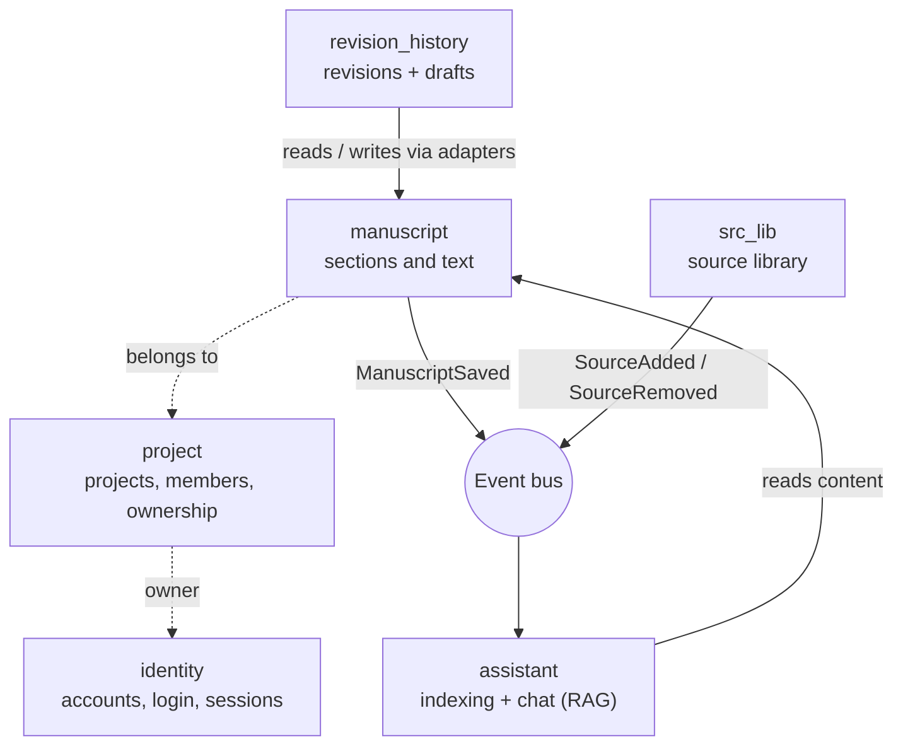
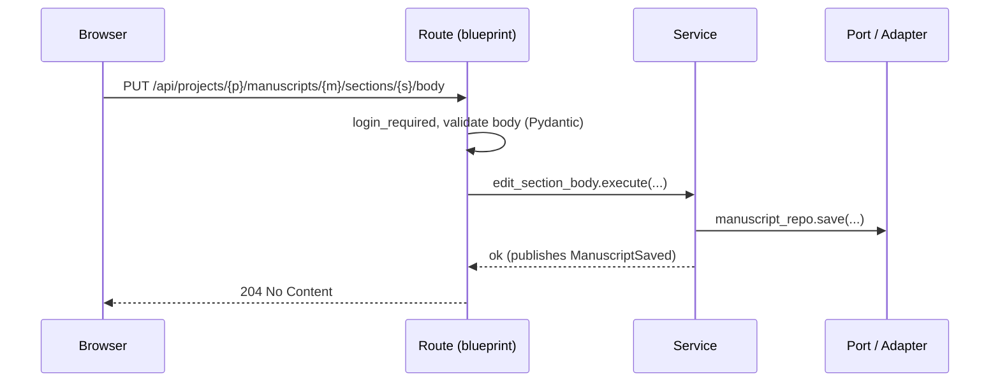
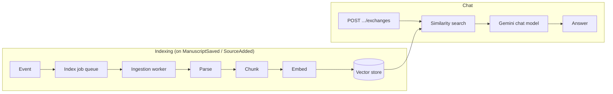

# Architecture

Theseus is a single deployable: a Svelte single-page app and a Flask API served from one origin. The
backend is organised as a set of **bounded contexts** using ports-and-adapters (hexagonal) design.

## System overview



## Bounded contexts



| Context            | Responsibility                                                              |
| ------------------ | --------------------------------------------------------------------------- |
| `identity`         | Register, log in, session identity. Passwords hashed with Argon2.           |
| `project`          | Create, rename, describe, delete projects; members; ownership transfer.    |
| `manuscript`       | Manuscripts with a tree of sections (heading, body, ordinal, parent).       |
| `revision_history` | Git-like history: revisions (commits) on drafts (branches); restore.        |
| `src_lib`          | Library of sources (title, authors, year, file reference).                  |
| `assistant`        | Index manuscripts into searchable chunks; answer questions with Gemini.     |

Contexts communicate through events on the in-process bus, not by calling each other's services.
`revision_history` reaches the manuscript through its own reader/writer adapters.

## Layering inside a context

```
domain/<context>/
  api/              Flask blueprint, Pydantic request models, API errors
  services/         Use cases (one class per operation)
  models/           Aggregates, entities, value objects, domain errors, events
  infrastructure/
    ports/          Interfaces the services depend on
    adapters/       In-memory and MongoDB (and Gemini/Chroma) implementations
```

Dependencies point inward: `api -> services -> models`, and services see only ports.
`bootstrap/` is the composition root. `build_container()` wires every module, defaulting to
in-memory adapters; `build_mongo_container()` swaps in MongoDB repositories. Tests use the
in-memory container, so they need no database or API key.

## Request flow



Domain errors are mapped to JSON responses in one place, `bootstrap/error_handlers.py`.

## AI assistant (retrieval-augmented chat)



Indexing runs asynchronously; poll `GET .../indexing-status` to see when a manuscript is searchable.

## Version control model

A manuscript has one or more **drafts** (branches). Each **revision** is an immutable snapshot of all
sections plus a message. `GET` on a manuscript returns the current draft's latest revision when history
exists; `?view=working` returns the working copy with uncommitted edits. Restoring a revision writes its
snapshot back into the working copy.

## Operational notes

- **Auth:** cookie session set by `/api/auth/login` and `/api/auth/register`.
- **Rate limits:** 100/day and 20/hour per IP by default; auth endpoints 5/minute. `/healthz` and static files are exempt.
- **Single worker:** the event bus, default vector store and limiter counters are in process memory.
- **Not yet wired:** the PostgreSQL identity adapter and the ChromaDB vector store exist but are unused. The vector store is in-memory, so the index is rebuilt after a restart.
