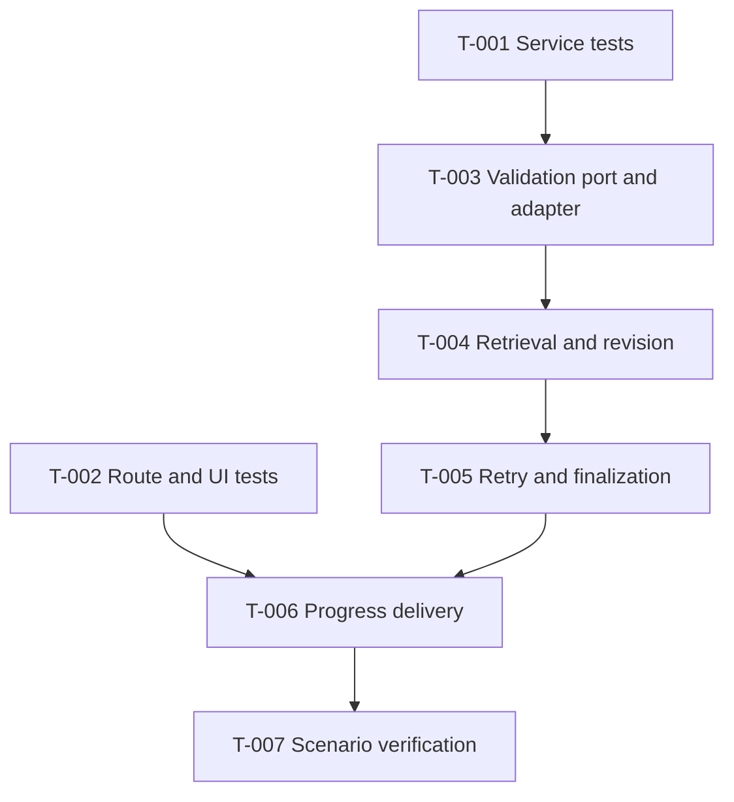

# Implementation tasks — Assistant answer validation

## Dependency graph

## Tasks

| ID | Work item | References | Depends on | Verification | Scenarios | Wave |
| --- | --- | --- | --- | --- | --- | --- |
| T-001 | Write service and adapter tests from the approved scenarios using scripted drafts, P1–P3, retrieval outcomes and a controllable clock. | R-001, R-002, R-003, R-004, R-005, R-007, R-008, R-009, R-010 | - | Run `pytest backend/tests/domain/assistant` before implementation. Record expected failures for missing checks, retries and terminal outcomes. | S-001, S-002, S-003, S-004, S-005, S-006, S-008, S-009, S-010, S-011 | 1 |
| T-002 | Write exchange-route and chat panel tests for progress and terminal events, including the existing JSON response. | R-006, R-007, R-008, R-010 | - | Run `pytest backend/tests/domain/assistant` and `npm --prefix frontend run test:components` before implementation. Confirm expected failures for missing progress and terminal messages. | S-007, S-008, S-009, S-011 | 1 |
| T-003 | Implement the verdict contract, citation checks and Gemini adapter. Wire the production validator through `bootstrap/contexts/assistant/module.py` and both container configurations in `bootstrap/container.py`, and inject scripted fakes for tests. | D-001, D-002 | T-001 | Run service and adapter tests for relevance, unsupported claims and incorrect citation targets. | - | 2 |
| T-004 | Implement focused retrieval and revision with stable passage references and distinct retrieval errors. | D-003 | T-003 | Exercise repeat search returning P2 and verify that P1 still identifies the original passage. | - | 3 |
| T-005 | Integrate validation, the shared retry budget, deadline and terminal outcomes into the exchange lifecycle. | D-001, D-004, D-005 | T-004 | Advance the fake clock through the deadline during a retry. Confirm late work cannot publish or save another answer. | - | 4 |
| T-006 | Connect server progress and final events to the chat panel, preserving the existing JSON exchange contract. | D-006 | T-002, T-005 | Exercise both response formats. Verify the progress event carries no draft and disappears on completion or error. | - | 5 |
| T-007 | Verify all Gherkin outcomes through the service, route and chat panel. | R-001, R-002, R-003, R-004, R-005, R-006, R-007, R-008, R-009, R-010, D-001, D-002, D-003, D-004, D-005, D-006 | T-006 | Run `ruff check backend/`, `mypy backend/`, `pytest backend/`, `npm --prefix frontend test` and `npm --prefix frontend run test:components`. Confirm all eleven scenario tests pass with fake sources and no live model. | S-001, S-002, S-003, S-004, S-005, S-006, S-007, S-008, S-009, S-010, S-011 | 6 |
