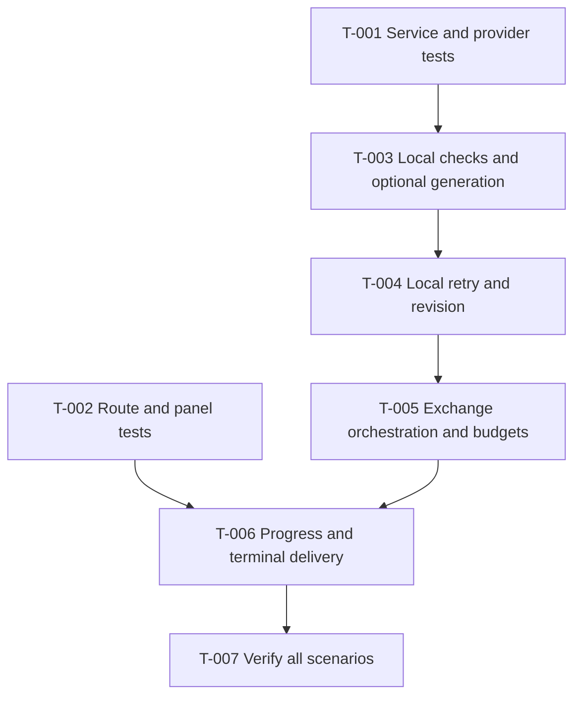

# Implementation tasks — Assistant answer validation

## Dependency graph

## Tasks

| ID | Work item | References | Depends on | Verification | Scenarios | Wave |
| --- | --- | --- | --- | --- | --- | --- |
| T-001 | Create or adapt service and adapter tests from approved Gherkin. Use one counting generation fake for every provider entry point, separate embedding counts, scripted passages and a fake clock. | R-001, R-002, R-003, R-004, R-005, R-007, R-008, R-009, R-010, R-011, R-012, R-013 | - | Run `pytest backend/tests/domain/assistant` before production edits. Cover proposal arrival before and at the cutoff, pending and rejected claims, and precedence of verified findings. Record expected failures for call counts and local checking. Cover exhausted allowance on failure and timeout, and a genuine excerpt with the wrong precision. | S-001, S-002, S-003, S-004, S-005, S-006, S-008, S-009, S-010, S-011, S-012, S-013, S-014, S-015, S-016, S-017, S-018, S-019 | 1 |
| T-002 | Retain and extend route and panel tests for both answer paths, partial answers, progress and errors. | R-001, R-006, R-007, R-008, R-010, R-013 | - | Run route and component suites before application changes. Verify opt-in reveal, the unverified label, and exclusion of rejected text. Verify the draft stays hidden during validation, progress arrives while validation is pending, and JSON and streamed answers expose only accepted citations. | S-004, S-007, S-008, S-009, S-011, S-013, S-014, S-015, S-017, S-018, S-019 | 1 |
| T-003 | Build local candidate extraction and claim-level checks. Adapt the Gemini path to propose excerpts and keys in one outbound request. Wire both through assistant bootstrap. | D-001, D-002, D-004 | T-001 | Compare direct and generated candidates against the same checker. Reject a month offered as a year, citation swaps and unsupported conclusions. Verify failed provider attempts are never automatically resent. | - | 2 |
| T-004 | Adapt evidence recovery and draft revision to operate locally after generation is spent. Keep the original source scope and keys supporting retained findings. | D-003 | T-003 | Verify an additional search can supply missing evidence, a local correction removes unsupported precision, and an exhausted retry yields only supported findings. Check manuscript attribution independently. | - | 3 |
| T-005 | Route source-backed exchanges through local selection before any model reply. Own the generation allowance, retry count, validation clock and terminal decision for the whole request. | D-001, D-004, D-005 | T-004 | Exercise the normal ask entry point. Assert zero or one generation attempt across the entire exchange, including retry, timeout and provider-error paths. Capture proposal arrival and per-claim check state before finalization. Verify exactly one recorded final answer or the specified interruption. | - | 4 |
| T-006 | Carry eligible draft text separately in the terminal response and reveal it on request in the panel. Preserve JSON, stream and history behavior. | D-006 | T-002, T-005 | Check the five-second boundary, one terminal record, and that displayed and reopened citations identify the locally accepted passages. | - | 5 |
| T-007 | Verify all 19 scenarios using fake sources and no live Gemini key. | D-001, D-002, D-003, D-004, D-005, D-006 | T-006 | Run `ruff check backend/`, `mypy backend/`, `pytest backend/`, `npm --prefix frontend test` and `npm --prefix frontend run test:components`. Confirm S-014 uses zero calls and S-015 to S-017 use one each, alongside their accuracy and fallback assertions. | S-001, S-002, S-003, S-004, S-005, S-006, S-007, S-008, S-009, S-010, S-011, S-012, S-013, S-014, S-015, S-016, S-017, S-018, S-019 | 6 |
