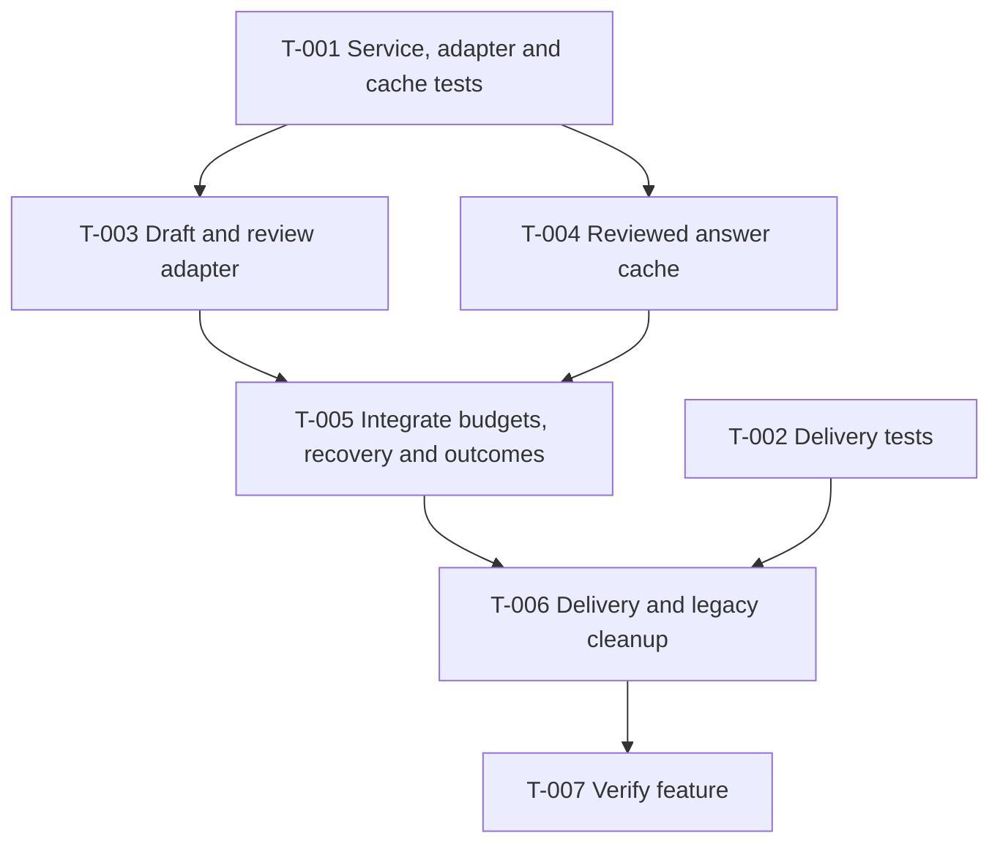

# Implementation tasks — Assistant answer validation

## Dependency graph

## Tasks

| ID | Work item | References | Depends on | Verification | Scenarios | Wave |
| --- | --- | --- | --- | --- | --- | --- |
| T-001 | Write service, cache and adapter tests first with a shared offline generation spy, fake clock and scripted retrieval. | R-001, R-002, R-003, R-004, R-005, R-006, R-007, R-008, R-009, R-010, R-011, R-012, R-013, R-014 | - | Run affected tests before application changes. Confirm expected failures for two-stage review, zero-call outcomes, invalidation, source access and failures. | S-001, S-002, S-003, S-004, S-005, S-006, S-008, S-009, S-010, S-011, S-012, S-013, S-014, S-015, S-016, S-017, S-018, S-019, S-020, S-021, S-022, S-023 | 1 |
| T-002 | Verify JSON, stream, progress, citations, errors and opt-in timeout display for fresh and reused answers. | D-005, D-006 | - | Run route and component suites before implementation. Assert exactly one terminal response and hidden pending text during validation. | S-004, S-007, S-008, S-009, S-011, S-013, S-014, S-017, S-018, S-019, S-022, S-023 | 1 |
| T-003 | Adapt the Gemini proposer and reviewer to make one attempt each. Review corrected findings and references in the same response. | D-002, D-004 | T-001 | Test malformed replies, swapped groups, unsupported precision, remaining timeout and disabled automatic resends. | - | 2 |
| T-004 | Build a bounded reviewed-answer cache with exact scope and evidence matching. | D-007 | T-001 | Test eviction, simultaneous access, every key dimension, recovery-evidence changes and exclusion of incomplete results. | - | 2 |
| T-005 | Wire retrieval, cache, draft, recovery and review into ChatService; enforce budgets and finalize once. | D-001, D-002, D-003, D-004, D-005, D-007 | T-003, T-004 | Exercise the normal ask path. Verify access before hits, empty versus failed search, 0/1/2 attempts, rejection of late results and no cache entry after failed save. | - | 3 |
| T-006 | Verify delivery and migrate useful legacy assertions before removing superseded branch-only checker and revision code. | D-005, D-006 | T-002, T-005 | Run delivery tests, check remaining imports and compare deletions against the PR base. Preserve supported citations and deadline behavior. | - | 4 |
| T-007 | Verify all 23 scenarios with offline provider and retrieval fakes. | D-001, D-002, D-003, D-004, D-005, D-006, D-007 | T-006 | Run backend lint, typing and pytest; frontend lint, unit and component suites; spec checker and Gherkin lint. Report scenario coverage and generation counts. | S-001, S-002, S-003, S-004, S-005, S-006, S-007, S-008, S-009, S-010, S-011, S-012, S-013, S-014, S-015, S-016, S-017, S-018, S-019, S-020, S-021, S-022, S-023 | 5 |
