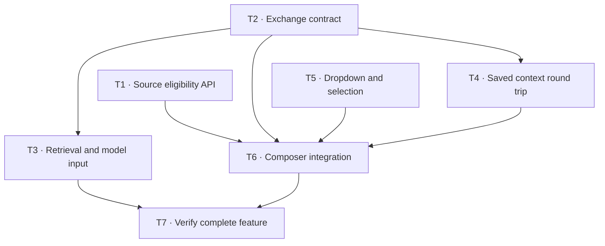

# Assistant context dropdown tasks

Use the task IDs below to schedule implementation. Each dependency is a prerequisite for completing the dependent task. The requirements and design accompany this checklist.

## Task dependency graph

## Implementation checklist

- [ ] **T1. Expose indexed source status** (R1). Inject the index-status lookup at bootstrap and include the boolean on each project source in the list response. Verify indexed and unindexed fixtures, with a source belonging to another project excluded. Depends on no other task.
- [ ] **T2. Extend the exchange contract** (R3–R6, R8). Accept `manuscript_and_source` with one UUID and manuscript text. Reject invalid combined requests (missing, empty or multiple IDs) in both `AskRequest` and `ChatService`, before `conversation.ask`, retrieval or a model call, so no pending exchange is left behind. The service raises a new `AssistantError` subclass that the existing `DomainError` handler maps to 400. Exercise the three existing scopes with their existing request forms. Depends on no other task.
- [ ] **T3. Assemble combined model input** (R3–R5, R8). Update service dispatch to independently gate manuscript inclusion and project-scoped retrieval. Run the 18-versus-24 comparison from the design with a distractor source. Verify both inputs reach one model call and that Manuscript and None skip retrieval. Depends on T2.
- [ ] **T4. Round-trip saved context** (R6). Carry combined scope and its UUID through the successful exchange, repository and conversation response. Verify reopening returns the same values and legacy conversations remain readable. Depends on T2.
- [ ] **T5. Build the dropdown and selection behavior** (R1, R2). Implement the two-value state, labels, eligible-source list and keyboard interactions using fixture data. Verify selection in either order, source replacement, clearing, empty library and focus return. Depends on no other task.
- [ ] **T6. Connect the composer, editor and thread** (R1–R8). Bind the list response, keep one active conversation across toggles, restore saved choices after loading and serialize the four payload shapes. Pass an `editorReady` prop from `editor.svelte` to `ChatPanel` and use it for the default selection, the disabled Manuscript item and restore timing. Check the size boundary, unsaved edits, loading state, failed send and retry with the current selection. Settle the open decision in the design (None to Manuscript when the editor becomes ready) first. Verify legacy or unavailable sources fall back according to scope. Depends on T1, T2, T4 and T5.
- [ ] **T7. Verify the complete feature** (R1–R8). Run the component and service cases referenced in the requirements. Exercise a combined exchange through the composer, reopen the conversation, switch to None and send a follow-up. Verify the same thread remains visible, the first answer received both references and the follow-up adds neither. Depends on T3 and T6.

Completion requires evidence for all eight requirements and the scenarios mapped to them in [requirements.md](requirements.md). The payload and restoration rules are in [design.md](design.md).
