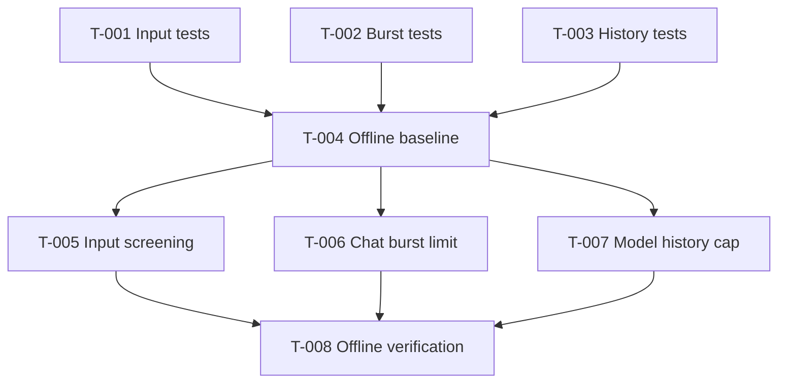

# Implementation tasks — Assistant chat safeguards

## Dependency graph

## Tasks

Run commands from the repository root. Include the scenario ID in each new pytest test name using the existing lowercase form (for example, `test_s010_...`) so the focused commands select it.

| ID | Work item | References | Depends on | Verification | Scenarios | Wave |
| --- | --- | --- | --- | --- | --- | --- |
| T-001 | Create offline service tests for both rejection types and both academic topics. Check errors, recorded calls, stored and pending exchanges, and returned answers. | D-001, D-004 | - | Run `python -m pytest backend/tests/domain/assistant -k "s010 or s011 or s015 or s016"`. Record any missing rejection behavior and confirm both academic examples execute. | S-010, S-011, S-015, S-016 | 1 |
| T-002 | Create offline endpoint tests for eleven questions from one client within one minute. Check ten answers, a rate-limit error, and ten model calls with limiting enabled. Check eleven answers under default test settings. | D-002, D-004 | - | Run `python -m pytest backend/tests/domain/assistant -k "s012 or s018"`. Check enabled and default test configurations independently. | S-012, S-018 | 1 |
| T-003 | Create offline service tests with ten and eleven distinguishable prior exchanges. Assert the exact model history and its order. Reload the conversation after the reply and check the prior exchanges remain intact. | D-003, D-004 | - | Run `python -m pytest backend/tests/domain/assistant -k "s013 or s017"`. Confirm any cap failure shows the unexpected prior exchange. | S-013, S-017 | 1 |
| T-004 | Run all new scenarios before application changes with network access blocked and live credentials absent. Record baseline passes and confirm failures reflect the missing behaviors. | D-004, R-006 | T-001, T-002, T-003 | Run `python -m pytest backend/tests/domain/assistant -v` offline. Check collection for every scenario and record expected behavioral failures before implementation. | S-014 | 2 |
| T-005 | Implement direct-input screening and propagate its error. Run the rejection and benign-question checks. | D-001 | T-004 | Rerun the T-001 command. Confirm rejected inputs leave history intact and academic questions receive answers. | S-010, S-011, S-015, S-016 | 3 |
| T-006 | Apply the chat submission limit and verify enforcement with default and explicitly enabled test configurations. | D-002 | T-004 | Rerun the T-002 command. Confirm ten model calls with limiting enabled and eleven answers under default test settings. | S-012, S-018 | 3 |
| T-007 | Cap completed history at the model boundary. Verify both history lengths against the recorded model call and stored conversation. | D-003 | T-004 | Rerun the T-003 command. Confirm exact forwarded order and full persisted history. | S-013, S-017 | 3 |
| T-008 | Rerun the complete safeguard suite offline with all changes together. Confirm each scenario and both academic-question examples pass. | D-004, R-006 | T-005, T-006, T-007 | Run `python -m pytest backend/tests/domain/assistant -v` offline. Confirm all nine scenarios, both academic examples, and existing assistant tests pass. | S-010, S-011, S-012, S-013, S-014, S-015, S-016, S-017, S-018 | 4 |

### T-004 offline baseline (2026-11-27)

Pytest collected 80 assistant tests covering S-010 through S-018. Before application changes, 76 passed and four failed. The run disabled dotenv loading, removed provider credentials from the test environment, and blocked outbound Python socket access.

| Scenarios | Baseline observation |
| --- | --- |
| S-010, S-016 and S-011 | Both direct prompts completed without raising the expected error (two failures). The tests stopped before checking stored and pending exchanges. |
| S-012 | With limiting enabled, the eleventh submission returned HTTP 201 instead of 429. |
| S-013 | The model received exchanges 1 through 11 instead of 2 through 11. The test stopped before its storage check. |
| S-014, S-015, S-017, S-018 | Offline provider verification, both academic questions, the ten-exchange boundary, and the default test burst passed. |
