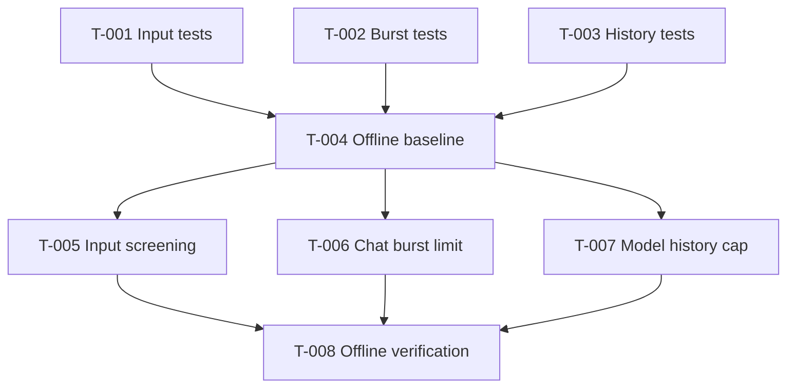

# Tasks: Assistant chat safeguards

## Task Breakdown

| ID | Task | References | Dependencies | Scenarios | Wave |
| --- | --- | --- | --- | --- | --- |
| T-001 | Create offline service tests for both rejection types and both academic topics. Check errors, recorded calls, stored and pending exchanges, and returned answers. | D-001, D-004 | - | S-010, S-011, S-015, S-016 | 1 |
| T-002 | Create offline endpoint tests for eleven questions from one client within one minute. Check ten answers, a rate-limit error, and ten model calls with limiting enabled. Check eleven answers under default test settings. | D-002, D-004 | - | S-012, S-018 | 1 |
| T-003 | Create offline service tests with ten and eleven distinguishable prior exchanges. Assert the exact model history and its order. Reload the conversation after the reply and check the prior exchanges remain intact. | D-003, D-004 | - | S-013, S-017 | 1 |
| T-004 | Run all new scenarios before application changes with network access blocked and live credentials absent. Record baseline passes and confirm failures reflect the missing behaviors. | D-004, R-006 | T-001, T-002, T-003 | S-014 | 2 |
| T-005 | Implement direct-input screening and propagate its error. Run the rejection and benign-question checks. | D-001 | T-004 | S-010, S-011, S-015, S-016 | 3 |
| T-006 | Apply the chat submission limit and verify enforcement with default and explicitly enabled test configurations. | D-002 | T-004 | S-012, S-018 | 3 |
| T-007 | Cap completed history at the model boundary. Verify both history lengths against the recorded model call and stored conversation. | D-003 | T-004 | S-013, S-017 | 3 |
| T-008 | Rerun the complete safeguard suite offline with all changes together. Confirm each scenario and both academic-question examples pass. | D-004, R-006 | T-005, T-006, T-007 | S-010, S-011, S-012, S-013, S-014, S-015, S-016, S-017, S-018 | 4 |

## Dependency Graph

