# Implementation tasks — Compare a manuscript with selected library sources

## Dependency graph

```mermaid
flowchart TD
    T001["T-001"]
    T002["T-002"]
    T003["T-003"]
    T004["T-004"]
    T005["T-005"]
    T006["T-006"]
    T007["T-007"]
    T008["T-008"]
    T009["T-009"]
    T010["T-010"]
    T011["T-011"]
    T012["T-012"]
    T013["T-013"]
    T014["T-014"]
    T015["T-015"]
    T016["T-016"]
    T017["T-017"]
    T018["T-018"]
    T019["T-019"]
    T020["T-020"]
    T021["T-021"]
    T022["T-022"]
    T023["T-023"]
    T024["T-024"]
    T025["T-025"]
    T026["T-026"]
    T027["T-027"]
    T028["T-028"]
    T029["T-029"]
    T030["T-030"]
    T031["T-031"]
    T032["T-032"]
    T033["T-033"]
    T034["T-034"]
    T035["T-035"]
    T036["T-036"]
    T037["T-037"]
    T038["T-038"]
    T039["T-039"]
    T040["T-040"]
    T041["T-041"]
    T001 --> T003
    T001 --> T004
    T003 --> T005
    T004 --> T005
    T002 --> T006
    T003 --> T006
    T002 --> T007
    T005 --> T007
    T006 --> T008
    T006 --> T009
    T006 --> T010
    T006 --> T011
    T006 --> T012
    T006 --> T013
    T007 --> T013
    T006 --> T014
    T007 --> T014
    T006 --> T015
    T007 --> T015
    T006 --> T016
    T006 --> T017
    T007 --> T017
    T006 --> T018
    T007 --> T018
    T006 --> T019
    T006 --> T020
    T006 --> T021
    T006 --> T022
    T007 --> T022
    T006 --> T023
    T007 --> T023
    T006 --> T024
    T007 --> T024
    T006 --> T025
    T006 --> T026
    T006 --> T027
    T006 --> T028
    T006 --> T029
    T007 --> T029
    T006 --> T030
    T007 --> T030
    T006 --> T031
    T006 --> T032
    T006 --> T033
    T006 --> T034
    T006 --> T035
    T006 --> T036
    T006 --> T037
    T007 --> T037
    T006 --> T038
    T007 --> T038
    T006 --> T039
    T007 --> T039
    T006 --> T040
    T007 --> T040
    T006 --> T041
    T007 --> T041
```

## Tasks

T-002 gates work derived from the brief beyond the current ticket. Verification rows use the existing scenario IDs. Execute every Examples row for each outline.

| ID | Work item | References | Depends on | Verification | Scenarios | Wave |
| --- | --- | --- | --- | --- | --- | --- |
| T-001 | Bind the existing Gherkin steps before application changes. Use a Gherkin parser with tagged Vitest component and pytest service adapters. Expand outline examples and include Background. | D-001, D-002, D-003, D-004 | - | Dry-run all 34 scenarios and every example. Fail on missing or ambiguous steps. | - | 1 |
| T-002 | Reconcile the brief-only behaviors in Open Questions with the ticket owner, then align intake and Gherkin before conditional work. | R-001, R-002, R-003, R-004 | - | Record decisions and review scenario assertions against the updated ticket. | - | 1 |
| T-003 | Implement send-time draft, selected IDs and separate quote, with backward-compatible exchange validation. | D-001, D-002 | T-001 | Inspect a combined request after an unsaved edit and verify legacy requests still decode. | - | 2 |
| T-004 | Implement project-scoped semantic retrieval and source attribution, including compatible indexing and reindexing. | D-002, D-003 | T-001 | Inspect fake vector queries and verify every returned passage belongs to an allowed source. | - | 2 |
| T-005 | Compose the combined prompt and resolve answer citations against supplied evidence. | D-004 | T-003, T-004 | Inspect the fake model call and citation map for a quoted claim with a competing manuscript claim. | - | 3 |
| T-006 | After ticket reconciliation, implement approved picker, Web, conversation and persistence behavior. | D-001, D-002 | T-002, T-003 | Exercise keyboard toggles, failed sends, legacy records and removed-source titles in both repositories. | - | 3 |
| T-007 | After ticket reconciliation, implement approved source accounting, threshold, budget and Web attribution rules. | D-003, D-004 | T-002, T-005 | Calibrate on labelled support, qualification, contradiction and unrelated passages. Check budget limits and isolated failures. | - | 4 |
| T-008 | Verify — Add a second source without losing the first source or the manuscript | D-001, D-002 | T-006 | Run the tagged component scenario using accessible controls and captured exchanges. | S-063 | 4 |
| T-009 | Verify — Removing one source narrows the next exchange | D-001, D-002 | T-006 | Run the tagged component scenario using accessible controls and captured exchanges. | S-064 | 4 |
| T-010 | Verify — Clear a combined selection to return to Web | D-001, D-002 | T-006 | Run the tagged component scenario using accessible controls and captured exchanges. | S-065 | 4 |
| T-011 | Verify — Clearing the last item returns to Web | D-001, D-002 | T-006 | Run the tagged component scenario using accessible controls and captured exchanges. | S-066 | 4 |
| T-012 | Verify — A combined send uses the draft as it reads when the writer asks | D-001, D-002 | T-006 | Run the tagged component scenario using accessible controls and captured exchanges. | S-067 | 4 |
| T-013 | Verify — Tell the writer which selected study supports the manuscript claim | D-002, D-003, D-004 | T-006, T-007 | Run all tagged examples with fake retrieval and model calls. Inspect allowed inputs and source outcomes. Evaluate the generated answer against the scenario figures, source names and attribution. | S-068 | 5 |
| T-014 | Verify — Address the quoted passage when the draft contains two related claims | D-002, D-003, D-004 | T-006, T-007 | Run all tagged examples with fake retrieval and model calls. Inspect allowed inputs and source outcomes. Evaluate the generated answer against the scenario figures, source names and attribution. | S-069 | 5 |
| T-015 | Verify — Standalone selections retain their reference boundaries | D-002, D-003, D-004 | T-006, T-007 | Run all tagged examples with fake retrieval and model calls. Inspect allowed inputs and source outcomes. | S-070 | 5 |
| T-016 | Verify — Add a source to a combined selection with the keyboard | D-001, D-002 | T-006 | Run the tagged component scenario using accessible controls and captured exchanges. | S-071 | 4 |
| T-017 | Verify — Explain a gap in one selected source while using the other | D-002, D-003, D-004 | T-006, T-007 | Run all tagged examples with fake retrieval and model calls. Inspect allowed inputs and source outcomes. Evaluate the generated answer against the scenario figures, source names and attribution. | S-072 | 5 |
| T-018 | Verify — None of the selected sources supplies usable evidence | D-002, D-003, D-004 | T-006, T-007 | Run all tagged examples with fake retrieval and model calls. Inspect allowed inputs and source outcomes. Evaluate the generated answer against the scenario figures, source names and attribution. | S-073 | 5 |
| T-019 | Verify — Select sources across searches in a long library | D-001, D-002 | T-006 | Run the tagged component scenario using accessible controls and captured exchanges. | S-074 | 4 |
| T-020 | Verify — The quoted passage travels as its own item | D-001, D-002 | T-006 | Run the tagged component scenario using accessible controls and captured exchanges. | S-075 | 4 |
| T-021 | Verify — Changing the context keeps the same conversation | D-001, D-002 | T-006 | Run the tagged component scenario using accessible controls and captured exchanges. | S-076 | 4 |
| T-022 | Verify — A source from another project is never used | D-002, D-003, D-004 | T-006, T-007 | Run all tagged examples with fake retrieval and model calls. Inspect allowed inputs and source outcomes. | S-077 | 5 |
| T-023 | Verify — Tell the writer when a selected study qualifies the claim | D-002, D-003, D-004 | T-006, T-007 | Run all tagged examples with fake retrieval and model calls. Inspect allowed inputs and source outcomes. Evaluate the generated answer against the scenario figures, source names and attribution. | S-078 | 5 |
| T-024 | Verify — Source check results are passed to the model | D-002, D-003, D-004 | T-006, T-007 | Run all tagged examples with fake retrieval and model calls. Inspect allowed inputs and source outcomes. | S-079 | 5 |
| T-025 | Verify — Start in general chat using the existing API scope | D-001, D-002 | T-006 | Run the tagged component scenario using accessible controls and captured exchanges. | S-080 | 4 |
| T-026 | Verify — Select all indexed sources while filtering by title | D-001, D-002 | T-006 | Run the tagged component scenario using accessible controls and captured exchanges. | S-081 | 4 |
| T-027 | Verify — Keep the all-selected indicator in sync with individual selections | D-001, D-002 | T-006 | Run the tagged component scenario using accessible controls and captured exchanges. | S-082 | 4 |
| T-028 | Verify — No indexed sources are available | D-001, D-002 | T-006 | Run the tagged component scenario using accessible controls and captured exchanges. | S-083 | 4 |
| T-029 | Verify — Turn off Web while keeping the manuscript and source selected | D-002, D-003, D-004 | T-006, T-007 | Run all tagged examples with fake retrieval and model calls. Inspect allowed inputs and source outcomes. Evaluate the generated answer against the scenario figures, source names and attribution. | S-084 | 5 |
| T-030 | Verify — General knowledge cannot stand in for missing source evidence | D-002, D-003, D-004 | T-006, T-007 | Run all tagged examples with fake retrieval and model calls. Inspect allowed inputs and source outcomes. Evaluate the generated answer against the scenario figures, source names and attribution. | S-085 | 5 |
| T-031 | Verify — Selecting Manuscript or a source keeps Web as it was | D-001, D-002 | T-006 | Run the tagged component scenario using accessible controls and captured exchanges. | S-086 | 4 |
| T-032 | Verify — Clearing the last selected item leaves Web checked | D-001, D-002 | T-006 | Run the tagged component scenario using accessible controls and captured exchanges. | S-087 | 4 |
| T-033 | Verify — Quoting without Manuscript shares only the quoted passage | D-001, D-002 | T-006 | Run the tagged component scenario using accessible controls and captured exchanges. | S-088 | 4 |
| T-034 | Verify — Quoting leaves the context selection unchanged | D-001, D-002 | T-006 | Run the tagged component scenario using accessible controls and captured exchanges. | S-089 | 4 |
| T-035 | Verify — Reopening a chat restores the selection from its last successful exchange | D-001, D-002 | T-006 | Run the tagged component scenario using accessible controls and captured exchanges. | S-090 | 4 |
| T-036 | Verify — Reopening a chat names a source that is no longer available | D-001, D-002 | T-006 | Run the tagged component scenario using accessible controls and captured exchanges. | S-091 | 4 |
| T-037 | Verify — Choosing all indexed sources checks every source in a large library | D-002, D-003, D-004 | T-006, T-007 | Run all tagged examples with fake retrieval and model calls. Inspect allowed inputs and source outcomes. | S-092 | 5 |
| T-038 | Verify — A source indexed after selecting all sources stays excluded until chosen | D-002, D-003, D-004 | T-006, T-007 | Run all tagged examples with fake retrieval and model calls. Inspect allowed inputs and source outcomes. | S-093 | 5 |
| T-039 | Verify — A source with many matches does not crowd out another selected source | D-002, D-003, D-004 | T-006, T-007 | Run all tagged examples with fake retrieval and model calls. Inspect allowed inputs and source outcomes. | S-094 | 5 |
| T-040 | Verify — A completed search with only below-threshold passages yields no match | D-002, D-003, D-004 | T-006, T-007 | Run all tagged examples with fake retrieval and model calls. Inspect allowed inputs and source outcomes. | S-095 | 5 |
| T-041 | Verify — Report a matching source whose evidence exceeds the available context window | D-002, D-003, D-004 | T-006, T-007 | Run all tagged examples with fake retrieval and model calls. Inspect allowed inputs and source outcomes. Evaluate the generated answer against the scenario figures, source names and attribution. | S-096 | 5 |
