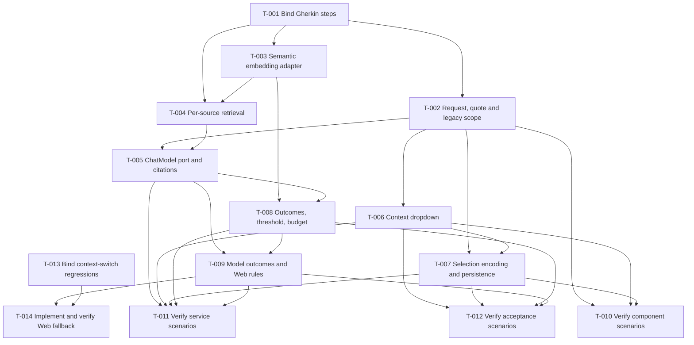

# Implementation tasks — Compare a manuscript with selected library sources

## Dependency graph

Each arrow points from a prerequisite to the task that depends on it. Keep the nodes and edges in sync with the task table, including tasks with no dependencies.

## Tasks

Use IDs from [requirements.md](requirements.md) and [design.md](design.md) in References. T-010, T-011 and T-012 verify the scenarios tagged `@component`, `@service` and `@acceptance`. Each runs every scenario and every Examples row in its group.

| ID | Work item | References | Depends on | Verification | Scenarios | Wave |
| --- | --- | --- | --- | --- | --- | --- |
| T-001 | Create executable tests from the approved `gherkin.feature` before application changes. For the backend, add pytest-bdd, pinned in `backend/requirements-dev.txt`. For the frontend, choose a Vitest-compatible Gherkin binder, pin it in `frontend/package.json` and record the choice in the pull request, or write one small shared parser instead. Expand outline examples and include Background. Route `@component` scenarios to Vitest and `@service` and `@acceptance` scenarios to pytest. Base assertions on each scenario's observable outcomes. | D-001, D-002, D-003, D-004, D-005, D-006, D-007, D-008, D-009 | - | Run all 35 scenarios and every example with the new runners before changing application code. Fail on missing or ambiguous steps, and confirm each scenario for new behavior fails for the expected reason. `ruff check backend/` and `mypy backend/` pass. | S-063, S-064, S-065, S-066, S-067, S-068, S-069, S-070, S-071, S-072, S-073, S-074, S-075, S-076, S-077, S-078, S-079, S-080, S-081, S-082, S-083, S-084, S-085, S-086, S-087, S-088, S-089, S-090, S-091, S-092, S-093, S-094, S-095, S-096, S-097 | 1 |
| T-002 | Implement the request changes: exact quote as its own field, draft text sent only when Manuscript is checked (a quote alone carries no other draft text), selected IDs and legacy `context_scope` decoding. | D-001, D-002 | T-001 | Extend `backend/tests/domain/assistant/api/test_ask_request.py` for combined, quote-only and legacy requests. `pytest backend/tests/domain/assistant`, `ruff check backend/` and `mypy backend/` pass. | - | 2 |
| T-003 | Add the semantic Gemini `EmbeddingGenerator` adapter and wire it in `container.py`. Add a reindex trigger that marks existing indexed documents stale (`IndexedDocument.mark_stale`) and re-queues them through `IndexJobQueue`, so the `IngestionWorker` replaces old vectors. | D-003 | T-001 | Test the adapter with a faked client, with no live key. Test that the trigger re-queues indexed documents and that reindexing replaces old vectors. Test that while old vectors remain in the store, a stale document is not searched and is reported unavailable. `pytest backend/tests/domain/assistant`, `ruff check backend/` and `mypy backend/` pass. | - | 2 |
| T-004 | Implement per-source semantic retrieval with the library entry ID and title on each passage, keeping the project-scoped intersection. Search with the question plus the quote or a bounded draft excerpt as D-003 describes. | D-002, D-003 | T-001, T-003 | Using `InMemoryVectorStore` and fake embeddings, assert every returned passage belongs to an allowed source of the project. Assert one source with many matches does not use up the others' share. Offline regression tests, with a fake embedder that fails on any unexpected search text, assert the exact text searched for a quote, for Manuscript checked without a quote, and for Manuscript unchecked. They also assert that a source reporting the figure is found by a question that does not restate the claim, and that a same-topic source that never reports it is left out. `pytest backend/tests/domain/assistant`, `ruff check backend/` and `mypy backend/` pass. | - | 3 |
| T-005 | Extend the `ChatModel` port and `GeminiChatModel` to take the history, draft, quote, question and labelled excerpts. Return citations resolved against the supplied excerpts and discard citations that match none. Pass the quote even when Manuscript is unchecked. Update the exchange route response and the test `FakeChatModel`. | D-004 | T-002, T-004 | Assert the fake model receives the quote as the comparison target and the citation map for a quoted claim with a competing manuscript claim. `pytest backend/tests/domain/assistant`, `ruff check backend/` and `mypy backend/` pass. | - | 4 |
| T-006 | Build the Context dropdown (Web, Manuscript, sources, Clear selection, title filter, All indexed sources) with immediate effect, keyboard support (arrow keys, Space, Escape returning focus to the Context button), Web as the default for new chats, the selection summary on the closed button, the Web fallback rules, and All indexed sources as the only bulk checkbox (snapshot at selection, disabled when no source is indexed). Remove the per-selection conversations. Add the assistant read endpoint for searchable library source IDs, excluding manuscript documents. | D-005, D-009 | T-002 | `npm --prefix frontend run test:components` and `npm run lint:frontend` pass. Exercise keyboard toggles, the filter, bulk selection and the no-indexed-sources state with accessible roles. `pytest backend/tests/domain/assistant` covers the new endpoint and checks that manuscript documents are excluded. | - | 3 |
| T-007 | Encode Web and Manuscript independently of the source UUIDs in `AskRequest` (Web alone keeps scope `none` with empty manuscript text and null source IDs) and accept more than 1,000 source IDs. Add the Web and Manuscript flags and selected ID and title pairs to `Conversation`. Save them only on success. Add defaults for old records, return them from `_conversation_json` and restore them in the Context dropdown, showing scope `none` as Web alone and naming a removed source while keeping the other choices. | D-006 | T-002, T-006 | Extend `test_ask_request.py` for scope `none`, independent flags and 1,001 IDs. Test both conversation repositories. Test the Mongo repository with a mocked collection, as in `test_mongodb_source_repository.py`. Cover failed sends, legacy records and removed-source titles. `pytest backend/`, `ruff check backend/` and `mypy backend/` pass. | - | 4 |
| T-008 | Implement the inclusive calibrated relevance threshold, the configurable passage budget, fair passage allocation, the evidence budget with its token counter port and Gemini-backed adapter, and batching for selections above 1,000. Track per-source search and admission results as unavailable, searched without a match or omitted for capacity. | D-007 | T-003, T-005 | Calibrate the threshold on labelled support, qualification, contradiction and unrelated passages with the semantic embedder. Test budget limits with a fake token counter and isolated per-source failures with fakes. `pytest backend/tests/domain/assistant`, `ruff check backend/` and `mypy backend/` pass. | - | 5 |
| T-009 | Add Web and no-Web instructions and keep factual findings tied to admitted passages. Carry the per-source outcomes from T-008 into generation and report the reason for each gap as specified in D-008. | D-008 | T-005, T-008 | Assert the fake model receives the Web flag and the outcomes that fit. For S-097, use a fake token counter to exercise zero and partial outcome capacity and compare the final named gaps with the full source list. Assert missing evidence is never labelled contradiction. `pytest backend/tests/domain/assistant`, `ruff check backend/` and `mypy backend/` pass. | - | 6 |
| T-010 | Verify the picker, exchange payloads and conversation restoration. | D-001, D-005, D-006, D-009 | T-002, T-006, T-007 | Run the component bindings with `npm --prefix frontend run test:components`, using keyboard input and captured exchanges. Check bulk selection across filters, failed sends, all legacy scopes and the legacy null-ID snapshot. After implementation, rerun and confirm every scenario in this group passes. | S-063, S-064, S-065, S-066, S-067, S-071, S-074, S-076, S-080, S-081, S-082, S-083, S-086, S-087, S-089, S-090, S-091 | 5 |
| T-011 | Verify quote boundaries, source isolation, snapshot selection and retrieval budgets. | D-002, D-003, D-004, D-006, D-007 | T-005, T-006, T-007, T-008, T-009 | Run the service bindings with `pytest backend/`. Check all 1,001 selected IDs, exact quote boundaries, the inclusive cutoff, first-pass coverage and the measured request size. Distinguish failed searches, below-cutoff results and capacity omissions. For S-096, when its outcome record fits, check the model request marks the omitted source and contains none of its passages. After implementation, rerun and confirm every scenario in this group passes. | S-070, S-075, S-077, S-079, S-088, S-092, S-093, S-094, S-095, S-096, S-097 | 7 |
| T-012 | Verify combined answers, attribution and handling of evidence gaps. | D-004, D-007, D-008 | T-006, T-007, T-008, T-009 | Automated: run the acceptance bindings with `pytest backend/` and assert the inputs the recording model receives (draft, quote, selected IDs, per-source outcomes, admitted passages). After implementation, rerun and confirm every scenario in this group passes. Manual or eval, outside CI and needing a Gemini key: check source titles, figures, labelled general knowledge and explanations for evidence gaps. | S-068, S-069, S-072, S-073, S-078, S-084, S-085 | 7 |
| T-013 | Bind the approved context-switch scenarios and exercise the provider instruction. | D-010 | - | Confirm the regression fails before implementation. | S-098, S-099 | 1 |
| T-014 | Implement and verify the Web fallback and current-turn scope. | D-010 | T-009, T-013 | Run both scenario bindings and the combined-context suite. | S-098, S-099 | 7 |
