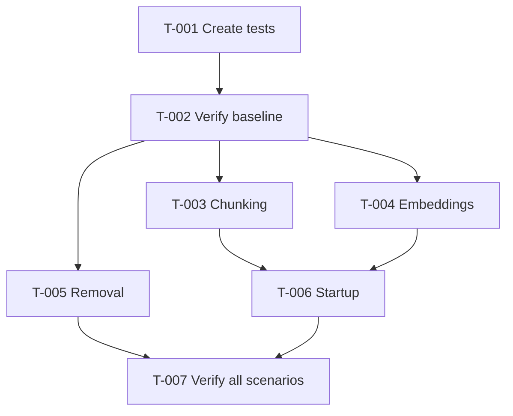

# Tasks for production RAG

## Task List

| ID | Task | References | Dependencies | Wave | Scenarios | Verification |
| --- | --- | --- | --- | --- | --- | --- |
| T-001 | Create executable scenario tests and offline fixtures before changing application code. | D-001, D-002, D-003, D-004, D-005 | - | 1 | S-019, S-020, S-021, S-022, S-023, S-024, S-025, S-026, S-027 | Check token limits, overlap, positions and hashes, blank input, ordered vectors, offline ranking, persistence after reopening, test storage isolation, scoped deletion and unknown-source removal. |
| T-002 | Run the new tests against the current implementation and record the baseline. | R-001, R-002, R-003, R-004, R-005, R-006 | T-001 | 2 | S-019, S-020, S-021, S-022, S-023, S-024, S-025, S-026, S-027 | Confirm missing behaviors fail for their expected assertions. Record already passing cases. Resolve fixture or model provisioning errors before implementation. |
| T-003 | Implement the production overlapping token chunker. | D-001 | T-002 | 3 | S-019, S-024 | Run long-paragraph and blank-input tests. |
| T-004 | Implement the local embedding generator for ingestion and query use. | D-002 | T-002 | 3 | S-020, S-027 | Check order, dimension, paraphrase ranking, and zero outbound attempts. |
| T-005 | Connect document-scoped vector deletion to source removal. | D-004 | T-002 | 3 | S-022, S-026 | Inspect both sources' vectors after removal, check remaining retrieval, and exercise the unknown-source path. |
| T-006 | Wire production adapters and persistent storage while retaining default test wiring. | D-003 | T-003, T-004 | 4 | S-021, S-025 | Retrieve an indexed passage through fresh wiring at the same isolated path. Verify test startup leaves production storage untouched. |
| T-007 | Run all scenario tests together offline and reconcile results with the feature. | D-005, R-001, R-002, R-003, R-004, R-005, R-006 | T-005, T-006 | 5 | S-019, S-020, S-021, S-022, S-023, S-024, S-025, S-026, S-027 | Record passing results for every scenario with network access blocked and live credentials absent. |

## Dependency Graph

