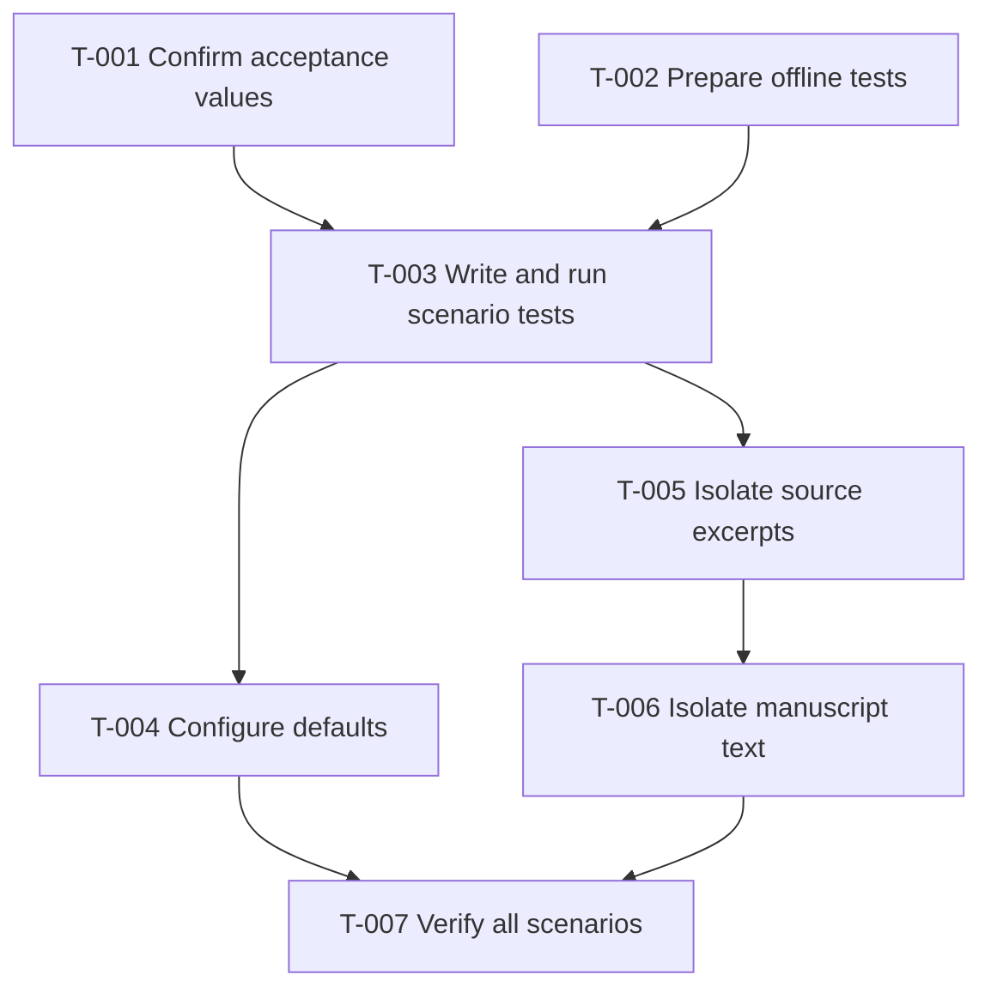

# Implementation tasks — Assistant Prompt Guardrails and Safety Controls

## Dependency graph

## Tasks

| ID | Work item | References | Depends on | Verification | Scenarios | Wave |
| --- | --- | --- | --- | --- | --- | --- |
| T-001 | Complete. Instruction obligations, fixed filter thresholds, and the S-009 examples are recorded in the requirements and Gherkin files respectively. | R-001, R-006 | - | Cross-check R-001 and R-002 and the three examples in S-009. | - | 1 |
| T-002 | Set up an offline provider substitute with a dummy key, capture outgoing requests, and disable external network access. | D-004 | - | Verify the substitute captures requests with networking disabled and a dummy credential. | S-005 | 1 |
| T-003 | Write executable checks for default configuration, none-scope instructions and history, final source and manuscript boundaries, embedded boundary text, empty inputs, and answer delivery in all three scopes. Run them before editing application code. Record existing passes and confirm missing behavior fails on the intended assertions. | D-001, D-002, D-003, D-004, D-005 | T-001, T-002 | From backend, run `python -m pytest tests/domain/assistant`. Record the scenario IDs and confirm missing behavior fails on the expected assertions before changing application code. | S-001, S-002, S-003, S-004, S-005, S-006, S-007, S-008, S-009 | 2 |
| T-004 | Apply the confirmed request defaults and verify explicit instruction overrides. | D-001 | T-003 | Inspect captured defaults, all four filters, and explicit instruction overrides. | S-001, S-002, S-008 | 3 |
| T-005 | Implement reference boundary encoding and apply it to retrieved locations and excerpts. Preserve the question and no-excerpt behavior. | D-002 | T-003 | Check outgoing source messages for ordinary excerpts, embedded markers, and empty retrieval. | S-003, S-006 | 3 |
| T-006 | Apply the boundary convention from T-005 to manuscript assembly and preserve the empty-manuscript behavior. | D-003 | T-005 | Check manuscript containment, the empty placeholder, and the question after the closing boundary. | S-004, S-007 | 4 |
| T-007 | Run all scenario checks with external networking unavailable. Verify controlled answer delivery and saved exchanges in every scope, run existing assistant regressions, and record results by scenario ID. | D-001, D-002, D-003, D-004, D-005 | T-004, T-006 | From backend, run `python -m pytest tests/domain/assistant` offline. Confirm passing coverage for every scenario and all three S-009 examples. | S-001, S-002, S-003, S-004, S-005, S-006, S-007, S-008, S-009 | 5 |
