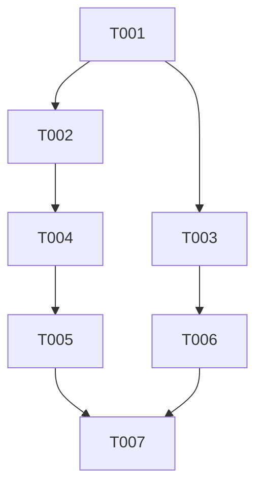

# Implementation tasks — OpenAuth login

## Dependency graph

## Tasks

| ID | Work item | References | Depends on | Verification | Scenarios | Wave |
| --- | --- | --- | --- | --- | --- | --- |
| T-001 | Resolve the open questions with the ticket owner. Update the ticket first, reconcile intake and Gherkin, obtain approval and refresh the specs and coverage below. | R-001, R-002, R-003, R-004 | - | Confirm each approved behavior traces to a ticket line before writing application code. | - | 1 |
| T-002 | Create backend scenario and storage contract tests from the approved Gherkin using a controlled provider. Include the migration and uniqueness races in design evidence. | D-001, D-002, D-003 | T-001 | Run `python -m pytest` in backend, including integration tests with the selected databases. For S-002, assert code response type, exactly the openid, email and profile scopes, and fresh nonempty state and nonce across starts. Have the provider verify the exchanged verifier against the S256 challenge. Record expected failures for missing behavior. | S-002, S-003, S-004, S-005, S-006, S-007, S-010, S-011, S-012, S-013, S-014, S-015, S-016, S-018, S-019, S-023, S-027, S-028 | 2 |
| T-003 | Create browser scenarios covering provider navigation, errors, reload, token exposure, HTTPS cookie flags and logout, including failed requests and lost responses. | D-001, D-004 | T-001 | Run `npm test` in e2e before frontend changes. For S-008, start at `/settings/profile` while signed out and assert the browser returns to that path after sign-in. Record failures against the observable Gherkin outcomes. | S-001, S-002, S-008, S-009, S-017, S-020, S-021, S-022, S-024, S-025, S-026 | 2 |
| T-004 | Implement approved account resolution, repository operations and migrations, including password-only compatibility and re-reading committed identities after either uniqueness conflict. | D-003 | T-002 | Run storage contracts on each selected adapter. Verify migration with two legacy password accounts, subsequent registration, duplicate identity rejection and both concurrency outcomes. | S-003, S-004, S-005, S-006, S-007, S-010, S-011 | 3 |
| T-005 | Wire provider configuration, pending requests, start and callback routes, account eligibility, session creation and approved audit behavior. | D-001, D-002, D-003 | T-004 | Run backend scenarios with real token validation against the controlled provider. Check session, writes and audit outcomes for each example. | S-002, S-003, S-004, S-005, S-006, S-007, S-010, S-011, S-012, S-013, S-014, S-015, S-016, S-018, S-019, S-023 | 4 |
| T-006 | Implement provider controls, return navigation, server-backed bootstrap and approved logout behavior. | D-004 | T-003 | Run frontend tests with session responses controlled. Verify logout on 204 or confirmed 401 and a retryable failure for an active or unknown session. | S-001, S-008, S-009, S-017, S-022 | 3 |
| T-007 | Run backend, storage and browser scenarios together against the completed app, including existing password sign-in and registration regressions. | D-001, D-002, D-003, D-004 | T-005, T-006 | Run `python -m pytest` in backend and `npm test` in e2e with the controlled provider and HTTPS. Record passing evidence for every scenario and outline example, including real cookie attributes and absence of tokens in logs and browser state. | S-001, S-002, S-003, S-004, S-005, S-006, S-007, S-008, S-009, S-010, S-011, S-012, S-013, S-014, S-015, S-016, S-017, S-018, S-019, S-020, S-021, S-022, S-023, S-024, S-025, S-026, S-027, S-028 | 5 |
