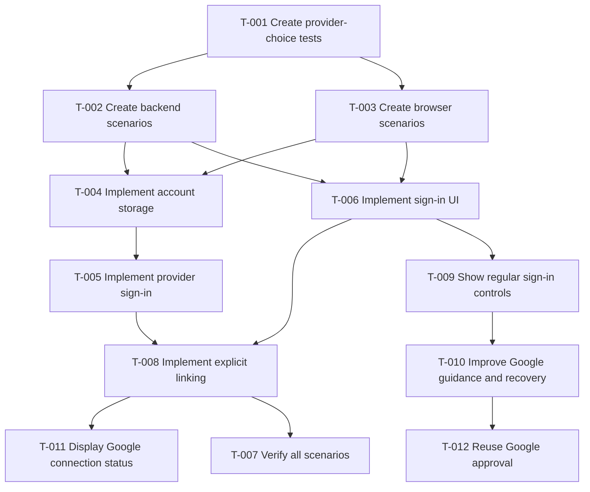

# Implementation tasks — OpenAuth login

## Dependency graph

## Tasks

| ID | Work item | References | Depends on | Verification | Scenarios | Wave |
| --- | --- | --- | --- | --- | --- | --- |
| T-001 | Create the executable login-page test for the single Google provider and its shared signed-out fixture. | R-001 | - | Run the test with npm test in e2e before implementation. Confirm it checks the Google button and absence of other OAuth choices and record any failure caused by a missing control. | S-001 | 1 |
| T-002 | Create backend scenario and storage contract tests from the approved Gherkin using a controlled provider. Include the migration and uniqueness races in design evidence. | D-001, D-002, D-003 | T-001 | Run `python -m pytest` in backend, including integration tests with the selected databases. For S-002, assert code response type, exactly the openid, email and profile scopes, and fresh nonempty state and nonce across starts. Have the provider verify the exchanged verifier against the S256 challenge. Record expected failures for missing behavior. | S-002, S-003, S-004, S-005, S-006, S-007, S-010, S-011, S-012, S-013, S-014, S-015, S-016, S-018, S-019, S-023, S-027, S-028 | 2 |
| T-003 | Create browser scenarios covering provider navigation, errors, reload, token exposure, HTTPS cookie flags and logout, including failed requests and lost responses. | D-001, D-004, D-005 | T-001 | Run `npm test` in e2e before frontend changes. For S-008, request an existing protected view while signed out and assert its content is restored after sign-in. For S-024, trigger the matching-email prompt, sign in with the existing method, explicitly link Google in the browser, sign out, then sign in through Google and assert the same account ID. Record failures against the observable Gherkin outcomes. | S-001, S-002, S-008, S-009, S-017, S-020, S-021, S-022, S-024, S-025, S-026 | 2 |
| T-004 | Implement approved account resolution, repository operations and migrations, including password-only compatibility and re-reading committed identities after either uniqueness conflict. | D-003, D-006 | T-002, T-003 | Run storage contracts on the in-memory, MongoDB and PostgreSQL adapters. Verify migration with two legacy password accounts, subsequent registration, duplicate identity rejection and both concurrency outcomes. | S-003, S-004, S-005, S-006, S-007, S-010, S-011 | 3 |
| T-005 | Wire provider configuration, pending requests, start and callback routes, account eligibility, session creation and existing audit behavior, claim allowlisting and token disposal on every exit. | D-001, D-002, D-003, D-006, D-008 | T-004 | Run backend scenarios with real token validation against the controlled provider. Check session, writes and audit outcomes for each example. | S-002, S-003, S-004, S-005, S-006, S-007, S-010, S-011, S-012, S-013, S-014, S-015, S-016, S-018, S-019, S-023 | 4 |
| T-006 | Implement provider controls, return navigation, server-backed bootstrap error and interruption recovery, editable profile name and existing sign-out flow. | D-004, D-006, D-007, D-008 | T-002, T-003 | Run frontend tests with session responses controlled. Verify logout on 204 or confirmed 401 and a retryable failure for an active or unknown session. | S-001, S-008, S-009, S-017, S-022, S-025, S-026 | 3 |
| T-007 | Run backend, storage and browser scenarios together against the completed app, including existing password sign-in and registration regressions. | D-001, D-002, D-003, D-004, D-005, D-006, D-007, D-008 | T-008 | Run `python -m pytest` in backend and `npm test` in e2e with the controlled provider and HTTPS. Record passing evidence for every scenario and outline example, including real cookie attributes and absence of tokens in logs and browser state. | S-001, S-002, S-003, S-004, S-005, S-006, S-007, S-008, S-009, S-010, S-011, S-012, S-013, S-014, S-015, S-016, S-017, S-018, S-019, S-020, S-021, S-022, S-023, S-024, S-025, S-026, S-027, S-028 | 6 |
| T-008 | Implement the signed-in Link provider control, authenticated link endpoint, and callback that saves the identity on the initiating account. | D-005 | T-005, T-006 | Run the S-024 browser test. Verify that switching accounts during authorization or presenting an identity owned by another account leaves existing links intact. | S-024 | 5 |
| T-009 | Test the unavailable Google choice, then implement persistent sign-in controls and verify configured navigation. | D-009 | T-006 | Run the sign-in component scenarios and verify the Google button on the regular dev page. | S-002, S-029 | 4 |
| T-010 | Test and implement registration guidance and recovery actions. | D-010 | T-009 | Verify distinct messages and a fresh Google authorization attempt. | S-030, S-031, S-032 | 5 |
| T-011 | Test and implement durable Google connection status. | D-011 | T-008 | Reopen Account after linking and verify the connected label. | S-033 | 6 |
| T-012 | Test returning sign-in and one interactive fallback, then implement remembered account selection and verify fresh authorization parameters. | D-012 | T-010 | Verify same account, logout, callback validation, account switching and protected return path. | S-034, S-035 | 6 |

## Verification evidence

The initial S-001 Playwright run reached the login page and failed to find the Google button. The first backend authorization tests received HTTP 404 from the start route. Additional storage and browser edge cases were added during implementation and verification.

| Scenarios | Executable evidence |
| --- | --- |
| S-001, S-002 | `e2e/openauth.spec.js` checks the Google-only choice and navigation. `backend/tests/domain/identity/test_openauth.py` checks fresh nonce and state, code response type, scopes and the verifier against the S256 challenge. |
| S-003, S-004, S-005, S-007, S-010, S-011 | Backend account tests exercise creation, repeat sign-in, password rejection, case-insensitive collisions and changed provider email. Storage contracts exercise simultaneous inserts, identity collisions and rollback on each adapter. |
| S-006, S-012 | Parameterized backend tests cover a missing name, whitespace and 51 characters, and unverified email for Google. |
| S-008, S-009, S-021, S-026 | `e2e/openauth-flow.spec.js` reopens Research Workspace, checks the account ID after reload, inspects Secure, HttpOnly and SameSite=Lax on the HTTPS cookie, and exercises both external return examples and a removed local page. |
| S-013, S-014, S-015, S-016, S-017, S-018, S-019 | Backend tests cover missing email, denial, provider error, timeout, suspension, missing or mismatched state, invalid signature, issuer, audience, expiry and nonce, and rejected codes. Browser tests check recovery text, retry, interruption and the password alternative. |
| S-020, S-023, S-027, S-028 | The browser fixture compares issued tokens with application logs and browser-visible data. Backend tests inspect stored account fields, session and pending data after success and failure. Password sign-in has no application-level success audit event. Both methods share the existing rejected-credentials audit hook. |
| S-022 | Browser tests exercise ordinary logout, a request that never arrives, a lost response after logout and a failed session check followed by retry. The existing registration and password sign-in regression also runs. |
| S-024, S-025 | The browser signs in with the existing password after a collision, explicitly links Google, signs out and verifies the original ID through Google. The profile edit survives reload. Backend tests reject cross-session linking and attempts to claim another account’s identity. |

Run `python -m pytest` from the repository root with `TEST_MONGODB_URI` and `TEST_POSTGRES_DSN` pointing to test services for the persistent storage cases. Run `npm test` in `e2e` with the backend Python environment on PATH. Playwright builds the frontend and starts a local HTTPS Theseus instance and controlled signing provider.

The completed run on 2026-11-25 passed 302 backend tests with MongoDB and PostgreSQL enabled, 19 HTTPS browser tests, 12 frontend unit tests and 51 frontend component tests. Ruff and mypy passed on the changed backend files.

### Google sign-in guidance and connection status

S-030 through S-033 are exercised by the HTTPS browser suite using a controlled Google provider. The tests check the first-time account guidance, restart from the expiry notice through a fresh authorization, the connection-failure retry action, and the persisted connected label after explicitly linking and reopening Account. Backend tests also cover expired attempts after store cleanup and connection failures that leave the session signed out.

### Returning Google users

S-034 and S-035 run with a controlled provider in a real browser. A signed-out browser reopens the same protected page as the same account without a consent click when its earlier grant is reusable. Removing the provider grant causes one interactive fallback. A separate browser test switches accounts explicitly. Backend tests check fresh state, nonce and PKCE on fallback and reject a silent response for a different subject.
