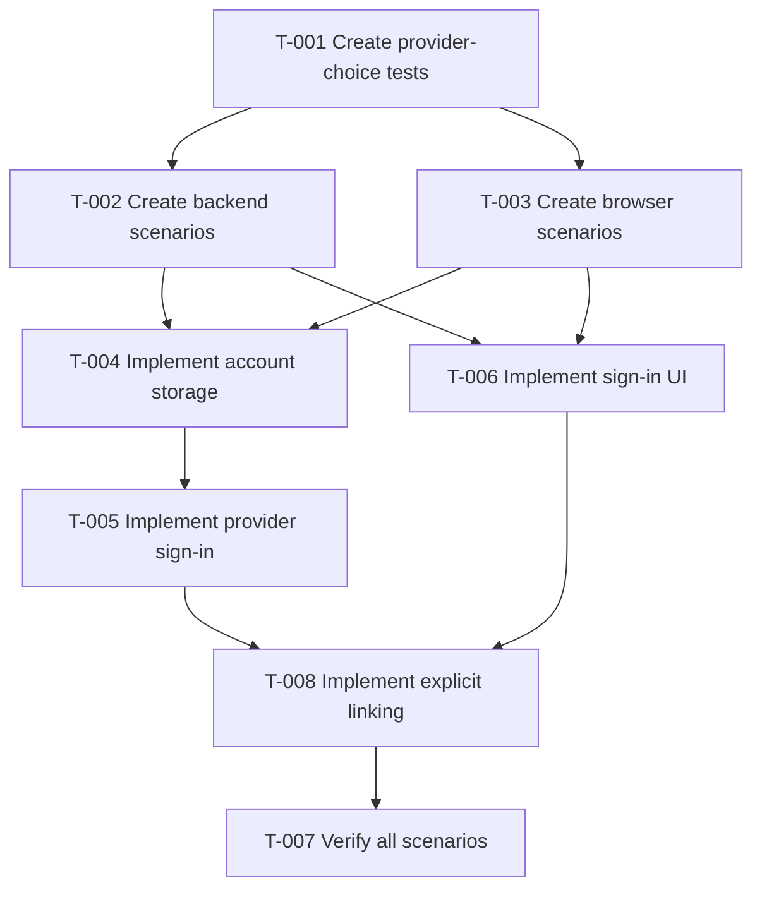

# Implementation tasks — OpenAuth login

## Dependency graph

## Tasks

| ID | Work item | References | Depends on | Verification | Scenarios | Wave |
| --- | --- | --- | --- | --- | --- | --- |
| T-001 | Create the executable login-page test for the two enabled providers and its shared signed-out fixture. | R-001 | - | Run the test with npm test in e2e before implementation. Confirm it checks both provider button labels and record any failure caused by a missing control. | S-001 | 1 |
| T-002 | Create backend scenario and storage contract tests from the approved Gherkin using a controlled provider. Include the migration and uniqueness races in design evidence. | D-001, D-002, D-003 | T-001 | Run `python -m pytest` in backend, including integration tests with the selected databases. For S-002, assert code response type, exactly the openid, email and profile scopes, and fresh nonempty state and nonce across starts. Have the provider verify the exchanged verifier against the S256 challenge. Record expected failures for missing behavior. | S-002, S-003, S-004, S-005, S-006, S-007, S-010, S-011, S-012, S-013, S-014, S-015, S-016, S-018, S-019, S-023, S-027, S-028 | 2 |
| T-003 | Create browser scenarios covering provider navigation, errors, reload, token exposure, HTTPS cookie flags and logout, including failed requests and lost responses. | D-001, D-004, D-005 | T-001 | Run `npm test` in e2e before frontend changes. For S-008, request an existing protected view while signed out and assert its content is restored after sign-in. For S-024, trigger the matching-email prompt, sign in with the existing method, explicitly link Google in the browser, sign out, then sign in through Google and assert the same account ID. Record failures against the observable Gherkin outcomes. | S-001, S-002, S-008, S-009, S-017, S-020, S-021, S-022, S-024, S-025, S-026 | 2 |
| T-004 | Implement approved account resolution, repository operations and migrations, including password-only compatibility and re-reading committed identities after either uniqueness conflict. | D-003, D-006 | T-002, T-003 | Run storage contracts on the in-memory, MongoDB and PostgreSQL adapters. Verify migration with two legacy password accounts, subsequent registration, duplicate identity rejection and both concurrency outcomes. | S-003, S-004, S-005, S-006, S-007, S-010, S-011 | 3 |
| T-005 | Wire provider configuration, pending requests, start and callback routes, account eligibility, session creation and existing audit behavior, claim allowlisting and token disposal on every exit. | D-001, D-002, D-003, D-006, D-008 | T-004 | Run backend scenarios with real token validation against the controlled provider. Check session, writes and audit outcomes for each example. | S-002, S-003, S-004, S-005, S-006, S-007, S-010, S-011, S-012, S-013, S-014, S-015, S-016, S-018, S-019, S-023 | 4 |
| T-006 | Implement provider controls, return navigation, server-backed bootstrap error and interruption recovery, editable profile name and existing sign-out flow. | D-004, D-006, D-007, D-008 | T-002, T-003 | Run frontend tests with session responses controlled. Verify logout on 204 or confirmed 401 and a retryable failure for an active or unknown session. | S-001, S-008, S-009, S-017, S-022, S-025, S-026 | 3 |
| T-007 | Run backend, storage and browser scenarios together against the completed app, including existing password sign-in and registration regressions. | D-001, D-002, D-003, D-004, D-005, D-006, D-007, D-008 | T-008 | Run `python -m pytest` in backend and `npm test` in e2e with the controlled provider and HTTPS. Record passing evidence for every scenario and outline example, including real cookie attributes and absence of tokens in logs and browser state. | S-001, S-002, S-003, S-004, S-005, S-006, S-007, S-008, S-009, S-010, S-011, S-012, S-013, S-014, S-015, S-016, S-017, S-018, S-019, S-020, S-021, S-022, S-023, S-024, S-025, S-026, S-027, S-028 | 6 |
| T-008 | Implement the signed-in Link provider control, authenticated link endpoint, and callback that saves the identity on the initiating account. | D-005 | T-005, T-006 | Run the S-024 browser test. Verify that switching accounts during authorization or presenting an identity owned by another account leaves existing links intact. | S-024 | 5 |
