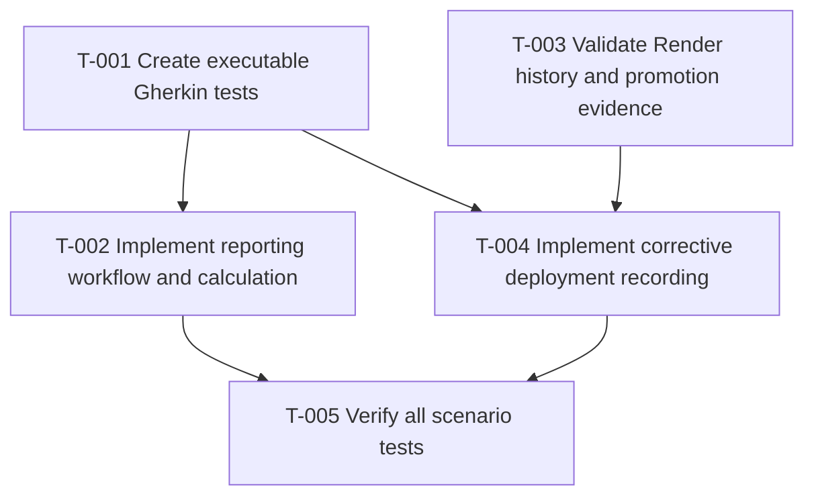

# Implementation tasks — Track DORA change failure rate

## Dependency graph

## Tasks

| ID | Work item | References | Depends on | Verification | Scenarios | Wave |
| --- | --- | --- | --- | --- | --- | --- |
| T-001 | Create pytest tests from all scenarios and outline examples using fixture deployment history, issue records, and workflow events. In the pending incident example, assert that the report identifies the specific issue. | R-001, R-002, R-003, R-004, R-005, R-006, R-007, R-008, R-009, R-010, R-011, R-012 | - | Run `python -m pytest backend/tests/devops/test_dora_change_failure_rate.py` before changing application code and confirm missing behaviors fail for the expected reasons. | S-028, S-029, S-030, S-031, S-032, S-033, S-034, S-035, S-036, S-037, S-038, S-039, S-040, S-041 | 1 |
| T-002 | Implement the manual and merge report triggers, production and incident evidence retrieval, time window, calculation, and job summary. | D-001, D-002, D-003, D-004 | T-001 | Check that both triggers use the same report entry point and that incomplete evidence identifies the gap and marks the rate unavailable. | - | 2 |
| T-003 | Validate the scheduled scan inputs and provenance for rollbacks, direct hotfixes, and unlabeled staging promotions. | D-005 | - | Confirm that successful rollback records expose the rollback trigger, including after deactivation. Verify newly shipped PR detection through ancestry and reviewed mappings when ancestry is obscured. | - | 1 |
| T-004 | Implement scheduled Render history reconciliation, hotfix provenance resolution, and incident issue writes keyed by corrective Render deploy ID. Render new issue bodies and linked issue comments from `specs/templates/devops/production-incident.md`. | D-005, D-006 | T-001, T-003 | Verify both write paths include the deployment marker, corrective action link, and pending attribution. Verify missed and partial scans can resume, unresolved provenance appears as an evidence gap, and retries leave a single entry and preserve maintainer attribution. | - | 2 |
| T-005 | Verify all approved scenarios through the workflow and reporting or issue-recording test entry points. | R-001, R-002, R-003, R-004, R-005, R-006, R-007, R-008, R-009, R-010, R-011, R-012 | T-002, T-004 | Run `python -m pytest backend/tests/devops/test_dora_change_failure_rate.py` and confirm all scenarios and outline examples pass. | S-028, S-029, S-030, S-031, S-032, S-033, S-034, S-035, S-036, S-037, S-038, S-039, S-040, S-041 | 3 |
