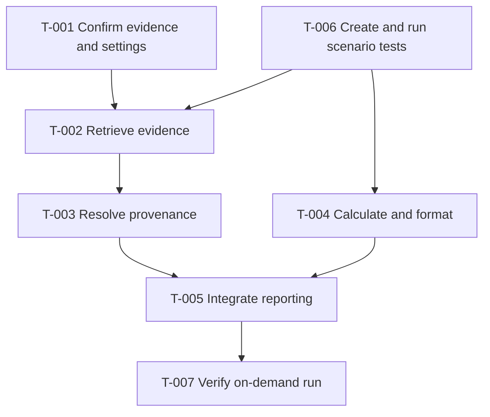

# Implementation tasks — Feature PR merge-to-production lead time

## Dependency graph

## Tasks

| ID | Work item | References | Depends on | Verification | Scenarios | Wave |
| --- | --- | --- | --- | --- | --- | --- |
| T-001 | Confirm available evidence, history coverage, manual production deployment settings, and that `DORA_FEATURE_LABEL` is set to `enhancement` for Theseus. | D-001, D-002, D-003 | - | Record the evidence contract and confirm production deploys are manually initiated. | - | 1 |
| T-002 | Retrieve and validate paginated GitHub and Render evidence. | D-001, D-002, D-004 | T-001, T-006 | Exercise incomplete-history and retrieval failures. | S-008, S-010 | 2 |
| T-003 | Resolve original PR provenance for direct merges and promotions. | D-001, D-004 | T-002 | Check that the configured label selects historical and current feature PRs, including with a different label in a fixture. Compare resolved PR identities and merge timestamps with fixture evidence. | S-001, S-009, S-010, S-011, S-076 | 3 |
| T-004 | Calculate and format the lead-time report. | D-002 | T-006 | Check empty windows, UTC boundaries, and first live timestamps. | S-004, S-005, S-006, S-007, S-075, S-077 | 2 |
| T-005 | Wire report-only manual dispatch, the repository label variable, and sanitized failure handling. | D-001, D-003, D-004 | T-003, T-004 | Confirm manual dispatch is the sole event, the workflow has no production deployment actions, and missing or blank label configuration fails with a sanitized diagnostic and withholds metrics. | S-001, S-008, S-010, S-078 | 4 |
| T-006 | Create and run executable tests from the approved Gherkin. | R-001, R-002, R-003, R-004, R-005, R-006 | - | Run the report tests before application changes and confirm missing behavior fails for the expected reason. Rerun the suite after any changes. | S-001, S-004, S-005, S-006, S-007, S-008, S-009, S-010, S-011, S-075, S-076, S-077, S-078 | 1 |
| T-007 | Verify an on-demand report against GitHub and Render evidence. | R-001, R-002, R-003, R-006 | T-005 | Record maintainer verification of the count, median, window, and sampled PR-to-deployment traces. | S-001, S-011 | 5 |

The existing implementation and verification status are recorded in [operations notes](operations.md).
