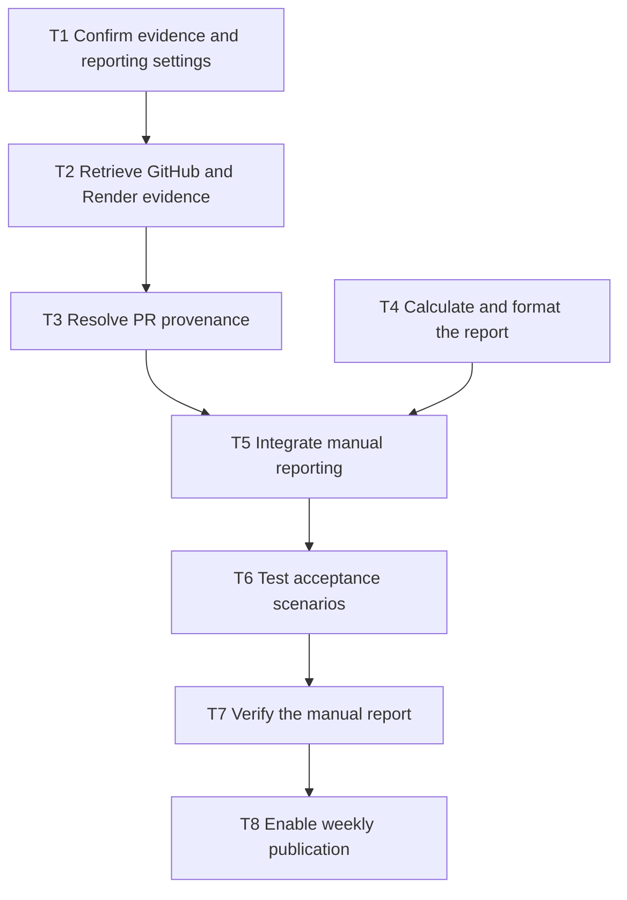

# Implementation tasks — Feature PR merge-to-production lead time

## Dependency graph

An arrow points from a prerequisite to a dependent task. The report calculation can be implemented with fixtures while the production evidence contract is being confirmed.

## Checklist

- [ ] **T1 — Confirm evidence and reporting settings.** Record the production service ID, deployment evidence and history coverage, GitHub feature PR classification, supported merge strategies, and authoritative promotion evidence. Confirm the weekly UTC schedule and publication surface. (R2–R5)
- [ ] **T2 — Retrieve GitHub and Render evidence.** Implement paginated retrieval of PRs, deployed revisions, and production deployment records. Validate required fields and history coverage. Report retrieval and coverage failures safely. (R2–R4)
- [ ] **T3 — Resolve PR provenance.** Resolve original feature PRs for direct merges, promotions containing multiple PRs, and supported rewritten histories. Fail when the deployed feature PRs cannot be identified. (R2, R4)
- [ ] **T4 — Calculate and format the report.** Deduplicate by PR identity using its earliest successful live deployment, apply the UTC window, and compute the count and median. Cover empty windows, even sample counts, and window boundaries. (R1–R3)
- [ ] **T5 — Integrate manual reporting.** Wire the evidence, calculation, and rendering into a manually dispatched workflow with read permissions, secret inputs, and sanitized failure handling. (R1, R4)
- [ ] **T6 — Test acceptance scenarios.** Cover S-001 and S-004 through S-011 with fixture-based tests, including incomplete history and safe handling of credential-bearing errors. Verify that a failed run publishes no metrics. (R1–R4)
- [ ] **T7 — Verify the manual report.** Run the workflow with repository data and have a maintainer verify the count, median, window, and sampled PR-to-deployment traces against GitHub and Render. Record the verified run before enabling the schedule. (R1–R5)
- [ ] **T8 — Enable weekly publication.** Configure the schedule and verify the withheld path with publication disabled. After T7, enable publication and verify that a scheduled run publishes a fresh report. Cover S-002 and S-003. (R5)
