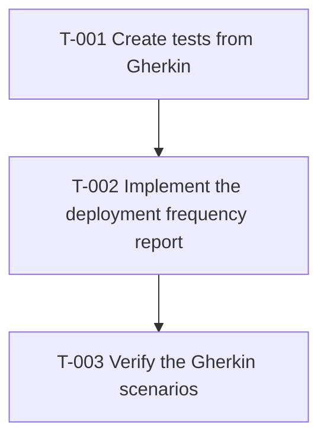

# Implementation tasks — Track DORA deployment frequency

## Dependency graph

## Tasks

| ID | Work item | References | Depends on | Verification | Scenarios | Wave |
| --- | --- | --- | --- | --- | --- | --- |
| T-001 | Create executable pytest tests from all Gherkin scenarios, including both examples of the scenario outline. Use deployment-history fixtures to assert the report output and workflow event cases to verify the merge trigger. | R-001, R-002, R-003, R-004, R-005, R-006, R-007 | - | Run `python -m pytest backend/tests/devops/test_dora_deployment_frequency.py` before changing application code and confirm the tests fail because the report behavior is missing. | S-021, S-022, S-023, S-024, S-025, S-026, S-027 | 1 |
| T-002 | Implement production deployment evidence retrieval, interval calculation, and job summary output. Configure Render authentication and production service selection, and verify the history anchor as described in the design. Configure the merge-to-main trigger, read all history pages, and apply the successful production deployment rule to rollbacks and redeployments. | D-001, D-002, D-003, D-004, D-005 | T-001 | Verify authenticated requests, service scoping, and first-deployment configuration for both an initial failed attempt and a verified never-deployed service. Confirm that a merge into main triggers a run, the report includes qualifying events on the earliest history page, and the job summary displays the resulting intervals. | - | 2 |
| T-003 | Verify the deployment frequency report against all Gherkin scenarios. | R-001, R-002, R-003, R-004, R-005, R-006, R-007 | T-002 | Run `python -m pytest backend/tests/devops/test_dora_deployment_frequency.py` and confirm all scenario cases pass. | S-021, S-022, S-023, S-024, S-025, S-026, S-027 | 3 |
