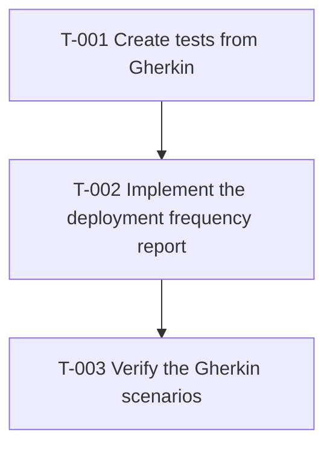

# Implementation tasks — Track DORA deployment frequency

## Dependency graph

## Tasks

| ID | Work item | References | Depends on | Verification | Scenarios | Wave |
| --- | --- | --- | --- | --- | --- | --- |
| T-001 | Create executable pytest tests from the four Gherkin scenarios, including both examples of the scenario outline. Use deployment-history fixtures and assert the observable report output. | R-001, R-002, R-003, R-004 | - | Run `python -m pytest backend/tests/devops/test_dora_deployment_frequency.py` before changing application code and confirm the tests fail because the report behavior is missing. | S-021, S-022, S-023, S-024 | 1 |
| T-002 | Implement production deployment evidence retrieval, interval calculation, and job summary output. Configure Render authentication and production service selection, and verify the history anchor as described in the design. Apply the agreed history window, cadence, and rollback and redeployment rules when configuring production reporting. | D-001, D-002, D-003 | T-001 | Verify authenticated requests, service scoping, and first-deployment configuration for both an initial failed attempt and a verified never-deployed service. Confirm that qualifying events reach the calculator and the job summary displays the result. | - | 2 |
| T-003 | Verify the deployment frequency report against all Gherkin scenarios. | R-001, R-002, R-003, R-004 | T-002 | Run `python -m pytest backend/tests/devops/test_dora_deployment_frequency.py` and confirm all scenario cases pass. | S-021, S-022, S-023, S-024 | 3 |
