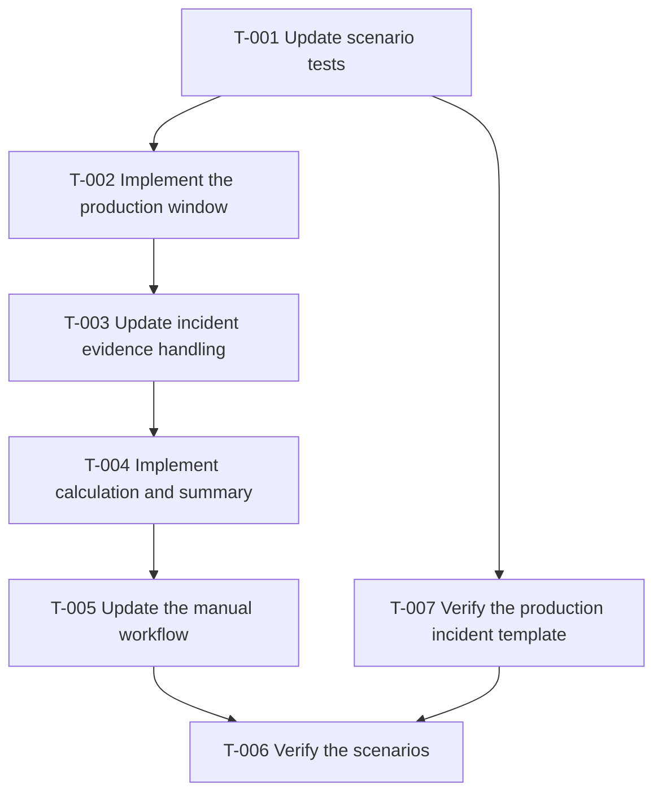

# Implementation tasks — Track deployment rework rate

## Dependency graph

## Tasks

| ID | Work item | References | Depends on | Verification | Scenarios | Wave |
| --- | --- | --- | --- | --- | --- | --- |
| T-001 | Update the executable pytest cases in `backend/tests/devops/test_dora_deployment_rework_rate.py` using the approved Gherkin outcomes. | R-001, R-002, R-003, R-004, R-005, R-006, R-007, R-008, R-009, R-010, R-011 | - | Run `python -m pytest backend/tests/devops/test_dora_deployment_rework_rate.py` before application changes. Confirm changed scenarios fail for the expected reason before updating application code. | S-046, S-047, S-048, S-049, S-050, S-051, S-052, S-053, S-054, S-055, S-056 | 1 |
| T-002 | Read and verify Render history and select the production arrivals in the UTC window. | D-002 | T-001 | Check both window boundaries, historically live arrivals, and the distinction between verified empty and incomplete history. | - | 2 |
| T-003 | Read valid rework confirmations from production incident comments and remove the separate deployment review issue reader. Track the deployment scope of unavailable incident evidence. | D-003 | T-002 | Verify confirmations count once per deployment and survive unrelated gaps. Check that readable incident evidence allows unconfirmed deployments in the production total and that known and unknown gaps affect only deployments whose rework status could change. | - | 3 |
| T-004 | Calculate the rate and publish the job summary for each evidence outcome. | D-004 | T-003 | Check the percentage, 0%, verified empty result, unverified production total, and counts of deployments affected by scoped and unscoped incident evidence gaps. | - | 4 |
| T-005 | Remove the deployment review issue configuration from the manual workflow. | D-001 | T-004 | Check the manual trigger, UTC start capture, read-only permissions, production service configuration, and job summary entry point. | - | 5 |
| T-006 | Run all scenario tests and check existing DevOps reporting for regressions. | R-001, R-002, R-003, R-004, R-005, R-006, R-007, R-008, R-009, R-010, R-011 | T-005, T-007 | Run `python -m pytest backend/tests/devops` and confirm every scenario passes. | S-046, S-047, S-048, S-049, S-050, S-051, S-052, S-053, S-054, S-055, S-056 | 6 |
| T-007 | Verify the existing **Deployment rework** section in `.github/ISSUE_TEMPLATE/production-incident.md`. | D-005 | T-001 | Check that the section explains when and how a maintainer records each qualifying corrective deployment using the supported incident comment. | S-054 | 2 |
