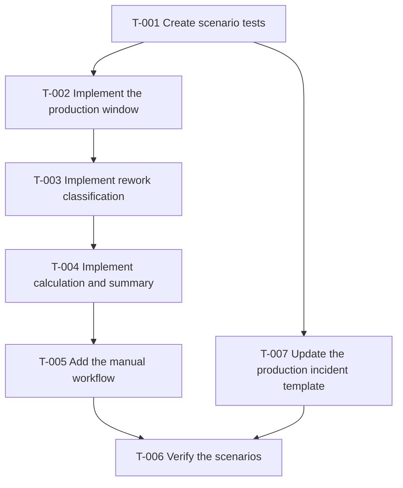

# Implementation tasks — Track deployment rework rate

## Dependency graph

## Tasks

| ID | Work item | References | Depends on | Verification | Scenarios | Wave |
| --- | --- | --- | --- | --- | --- | --- |
| T-001 | Create executable pytest cases in `backend/tests/devops/test_dora_deployment_rework_rate.py` using the approved Gherkin outcomes. | R-001, R-002, R-003, R-004, R-005, R-006, R-007, R-008, R-009, R-010 | - | Run `python -m pytest backend/tests/devops/test_dora_deployment_rework_rate.py` before application changes. Confirm failures are caused by missing report behavior or template guidance. | S-046, S-047, S-048, S-049, S-050, S-051, S-052, S-053, S-054 | 1 |
| T-002 | Read and verify Render history and select the production arrivals in the UTC window. | D-002 | T-001 | Check both window boundaries, historically live arrivals, and the distinction between verified empty and incomplete history. | - | 2 |
| T-003 | Read and validate incident confirmations and per-deployment maintainer dispositions. Classify the verified production population by deploy ID. | D-003 | T-002 | Check maintainer confirmation, repeated links, incidents of any cause, explicit no-rework dispositions, and missing dispositions with and without candidate flags. | - | 3 |
| T-004 | Calculate the rate and publish the job summary for each evidence outcome. | D-004 | T-003 | Check the percentage, 0%, verified empty result, and both incomplete-evidence paths. | - | 4 |
| T-005 | Wire the report to a dedicated manual workflow with one captured UTC start and read-only evidence configuration, including the deployment review issue. | D-001 | T-004 | Check the dispatch trigger, report start capture, evidence configuration, and job summary entry point. | - | 5 |
| T-006 | Run all scenario tests and check existing DevOps reporting for regressions. | R-001, R-002, R-003, R-004, R-005, R-006, R-007, R-008, R-009, R-010 | T-005, T-007 | Run `python -m pytest backend/tests/devops` and confirm every scenario passes. | S-046, S-047, S-048, S-049, S-050, S-051, S-052, S-053, S-054 | 6 |
| T-007 | Add the **Deployment rework** section to `.github/ISSUE_TEMPLATE/production-incident.md`. | D-005 | T-001 | Check that the section explains when and how a maintainer records each qualifying corrective deployment using the supported incident comment. | S-054 | 2 |
