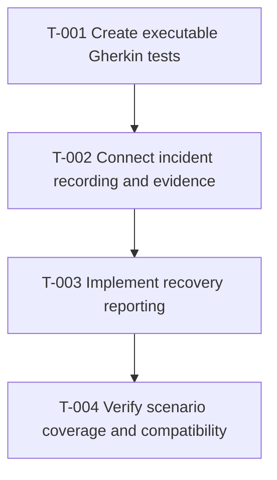

# Implementation tasks — Track failed deployment recovery time

## Dependency graph

## Tasks

| ID | Work item | References | Depends on | Verification | Scenarios | Wave |
| --- | --- | --- | --- | --- | --- | --- |
| T-001 | Create pytest cases from every approved scenario and outline example. Use incident issues, timeline evidence, and corrective deployment fixtures. Assert the observable incident entries, durations, statuses, counts, median, and message specified by the scenarios. For manual refresh, assert that the summary includes older and newly recorded qualifying incidents and the UTC run time. Exercise the maintainer action that links both corrective deployments to the existing record. Add compatibility cases for a CFR-generated issue before and after recovery confirmation for reuse of a maintainer-created issue during reconciliation, and for the late-link procedure. Cover label lookup failures and valid and invalid linked Render Live evidence. | R-001, R-002, R-003, R-004, R-005, R-006, R-007, R-008, R-009, R-011, R-012, R-013, R-014 | - | Run `python -m pytest backend/tests/devops/test_dora_failed_deployment_recovery_time.py` before application changes and confirm missing behaviors fail for the expected reasons. | S-046, S-047, S-048, S-049, S-050, S-051, S-052, S-053, S-054, S-055, S-056, S-057, S-058, S-059, S-060, S-061, S-062 | 1 |
| T-002 | Provision the recovery label as part of rollout. Document the label, confirmation and timeline comment formats, the Render Live example, and the late-link procedure in the production incident instructions. Verify the label is available before reading labelled issues across all states, verify comment authors, and apply the eligibility, timeline ordering, and conflict rules in the design. Support adding recovery details to CFR-generated issues and propagate incident loading failures. | D-001, D-002, D-003, D-005, D-007, D-008 | T-001 | Confirm the label exists and a failed lookup yields incomplete evidence. Confirm maintainers can record a failure before a correction, link later corrections to that issue, or add recovery details to an existing CFR-generated issue. Confirm CFR-generated evidence alone does not qualify, a confirmed incident appears once, and restoration can be recorded independently of a timestamp or corrective deployment. Confirm that a disputed timestamp remains unknown until explicitly resolved and that an earlier restoration is treated as unknown. | - | 2 |
| T-003 | Implement the recovery report entry point, qualifying incident filter, elapsed duration calculation, status classification, and report formatting. Add a manually dispatched GitHub Actions workflow that publishes the report in its job summary. Configure GitHub access independently as specified in the design. Show issue-linked timeline diagnostics and distinguish an incident load failure from an empty report. | D-002, D-003, D-004, D-005, D-006, D-007, D-008 | T-002 | Confirm each qualifying issue contributes to exactly one count and the median uses only completed durations. Confirm report output includes the prescribed empty-sample message when appropriate. Verify manual dispatch reads current incident records across all dates and shows the captured UTC run time. Verify the recovery entry point accepts confirmed Render Live evidence from an incident with the four settings in the [repository configuration inventory](repo-findings.md) unset. Verify unusable timestamps produce missing-timestamp entries and load failures produce an incomplete-evidence summary. | - | 3 |
| T-004 | Verify the approved scenarios through the incident recording and recovery report entry points. Check compatibility with the existing incident reader and writer used by change failure rate, including preservation of CFR records after the late-link procedure. | R-001, R-002, R-003, R-004, R-005, R-006, R-007, R-008, R-009, R-010, R-011, R-012, R-013, R-014 | T-003 | Run `python -m pytest backend/tests/devops/test_dora_failed_deployment_recovery_time.py backend/tests/devops/test_dora_change_failure_rate.py` and confirm all approved scenarios, outline examples, and compatibility tests pass. | S-046, S-047, S-048, S-049, S-050, S-051, S-052, S-053, S-054, S-055, S-056, S-057, S-058, S-059, S-060, S-061, S-062 | 4 |
