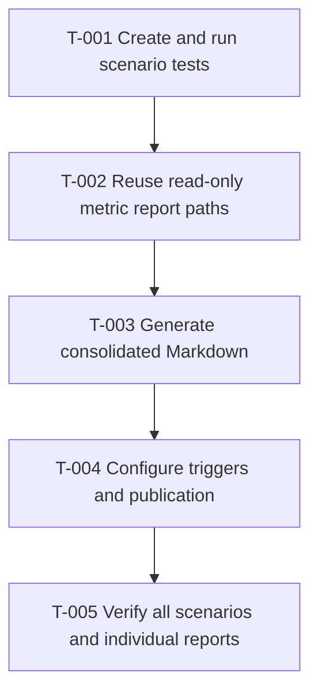

# Implementation tasks — Scheduled DORA metrics report

## Dependency graph

## Tasks

| ID | Work item | References | Depends on | Verification | Scenarios | Wave |
| --- | --- | --- | --- | --- | --- | --- |
| T-001 | Create executable pytest cases in `backend/tests/devops/test_dora_scheduled_report.py` from the five Gherkin scenarios. Use controlled GitHub and Render evidence, a fixed UTC clock, and a temporary output directory. Assert the configured triggers, observable publication behavior, and read-only operation. | R-001, R-002, R-003, R-004, R-005, R-006, R-007, R-008, R-009, R-010, R-011, R-012 | - | Run `python -m pytest backend/tests/devops/test_dora_scheduled_report.py` before application changes and confirm the tests fail because the consolidated workflow or report behavior is absent. | S-079, S-080, S-081, S-082, S-083 | 1 |
| T-002 | Expose callable report paths for the consolidated command while preserving the standalone CLI and workflows. Reuse the read-only evidence paths and existing per-metric periods. | D-002, D-005 | T-001 | Run the existing individual DORA pytest cases and compare metric results for identical fixture evidence and reference times. Confirm the report uses change failure rate report mode. | - | 2 |
| T-003 | Generate the five Markdown sections and UTC generation timestamp. Handle evidence gaps independently and write the credential-free report to the run-local output directory. | D-003, D-004, D-005 | T-002 | Check the full-evidence and missing-evidence fixtures. Confirm one file is written at the expected path and that fixture credentials are absent from its contents. | - | 3 |
| T-004 | Wire up the scheduled and manual triggers, read permissions, and shared report job. Publish the full file to ordered summary steps, adding jobs if needed, and upload one artifact with the report path preserved. Use manual dispatch as the sole recovery path for a dropped schedule. | D-001, D-004, D-005 | T-003 | Check that both triggers use the same job and that the Saturday 16:00 UTC schedule maps to Sunday 00:00 Manila time. Verify single-step output and ordered chunking above 1 MiB, including multibyte text and the per-job summary count limit. Confirm combined summary chunks reproduce the downloadable file byte for byte and that the only recovery trigger is manual dispatch. | - | 4 |
| T-005 | Verify all five scenarios and run the individual-report regression suite. | R-001, R-002, R-003, R-004, R-005, R-006, R-007, R-008, R-009, R-010, R-011, R-012 | T-004 | Run `python -m pytest backend/tests/devops`. Confirm every scenario passes. Check the run summary and download on a manually dispatched GitHub Actions run, and confirm automatic invocation on the first scheduled default-branch run. | S-079, S-080, S-081, S-082, S-083 | 5 |
