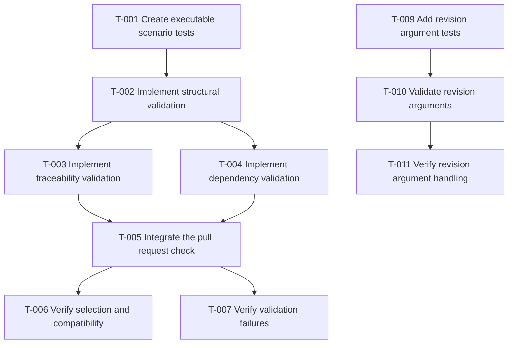

# Implementation tasks — Check spec files against repository templates

## Dependency graph

## Tasks

| ID | Work item | References | Depends on | Verification | Scenarios | Wave |
| --- | --- | --- | --- | --- | --- | --- |
| T-001 | Create executable tests from the Gherkin, including every example row. Use temporary repository fixtures to exercise selection, check status, and diagnostics. | R-001, R-002, R-003, R-004, R-005, R-006, R-007, R-008 | - | Run `python3 -m unittest discover -s scripts/tests -p test_spec_check.py -v` before implementation and confirm failures correspond to the missing check behavior. | S-012, S-013, S-014, S-015, S-016, S-017, S-018 | 1 |
| T-002 | Implement template-based structure and ID validation. | D-002 | T-001 | Confirm the structure cases exercise missing headings and columns and malformed and duplicate IDs for each applicable table. | - | 2 |
| T-003 | Implement ticket, scenario, design, and task reference and coverage checks. | D-003, D-004 | T-002 | Confirm the reference cases cover absent sources, blank and nonexistent lines, unknown IDs, and missing coverage. | - | 3 |
| T-004 | Implement task dependency graph, cycle, and wave checks. | D-005 | T-002 | Confirm the graph cases cover edge and node agreement, cycles, and both independent and dependent waves. | - | 3 |
| T-005 | Integrate feature-directory selection, validator diagnostics, and the final check status into the pull request workflow. | D-001, D-006 | T-003, T-004 | Confirm only added or modified feature spec files select directories and validator failures reach the check result with the affected file and rule. | - | 4 |
| T-006 | Verify conforming pull requests pass, unrelated legacy specs are ignored, non-spec changes leave the check idle, and intake and Gherkin checks remain available. | R-001, R-002, R-003, R-008 | T-005 | Run `python3 -m unittest discover -s scripts/tests -p test_spec_check.py -v` and confirm the selection and compatibility scenarios pass. | S-012, S-013, S-014 | 5 |
| T-007 | Verify each invalid fixture fails with its expected file and rule. | R-003, R-004, R-005, R-006, R-007 | T-005 | Run `python3 -m unittest discover -s scripts/tests -p test_spec_check.py -v` and confirm every validation failure example passes. | S-015, S-016, S-017, S-018 | 5 |
| T-009 | Add CLI tests for both invalid argument positions and both valid comparison modes. | R-009, R-010 | - | Run the spec check test file before implementation and confirm the invalid-input cases fail on the expected diagnostics. | S-019, S-020 | 1 |
| T-010 | Validate each supplied revision before passing revisions to Git. | D-007 | T-009 | Confirm invalid inputs produce an argument-specific CLI error. | - | 2 |
| T-011 | Verify revision argument handling and existing spec validation. | R-009, R-010 | T-010 | Run `python3 -m pytest backend/tests/devops/test_spec_check.py` and confirm all scenarios pass. | S-019, S-020 | 3 |
