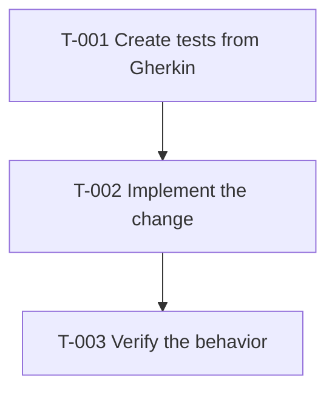

# Implementation tasks — [Feature name]

## Dependency graph

Each arrow points from a prerequisite to the task that depends on it. Keep the nodes and edges in sync with the task table, including tasks with no dependencies.

## Tasks

Use IDs from [requirements.md](requirements.md) and [design.md](design.md) in References. Link every design decision to a task and every scenario in `gherkin.feature` to a verification task. Separate multiple IDs with commas. Use `-` for empty dependencies or scenarios. Tasks with no prerequisites are in wave 1. Each dependent task is one wave after its latest prerequisite.

Start by creating executable tests from the approved `gherkin.feature`. Base assertions on the scenarios' observable outcomes. Make application code tasks depend on the corresponding test creation tasks.

| ID | Work item | References | Depends on | Verification | Scenarios | Wave |
| --- | --- | --- | --- | --- | --- | --- |
| T-001 | [Create an executable test from the approved Gherkin scenario.] | R-001 | - | [Give the command to run the test before implementation and confirm it fails for the expected reason if the behavior is missing.] | S-001 | 1 |
| T-002 | [Implement the change.] | D-001 | T-001 | [Describe the implementation check.] | - | 2 |
| T-003 | [Verify the behavior.] | R-001 | T-002 | [Give the command that runs the scenario and confirm it passes.] | S-001 | 3 |
