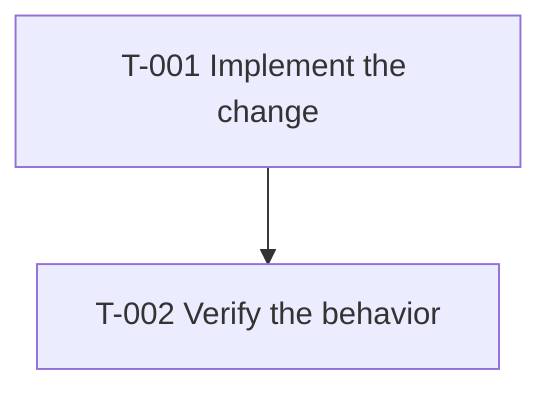

# Implementation tasks — [Feature name]

## Dependency graph

Each arrow points from a prerequisite to the task that depends on it. Keep the nodes and edges in sync with the task table, including tasks with no dependencies.

## Tasks

Use IDs from [requirements.md](requirements.md) and [design.md](design.md) in References. Link every design decision to a task and every scenario in `gherkin.feature` to a verification task. Separate multiple IDs with commas. Use `-` for empty dependencies or scenarios. Tasks with no prerequisites are in wave 1. Each dependent task is one wave after its latest prerequisite.

| ID | Work item | References | Depends on | Verification | Scenarios | Wave |
| --- | --- | --- | --- | --- | --- | --- |
| T-001 | [Implement the change.] | D-001 | - | [Describe the implementation check.] | - | 1 |
| T-002 | [Verify the behavior.] | R-001 | T-001 | [Give the test command or manual check.] | S-001 | 2 |
